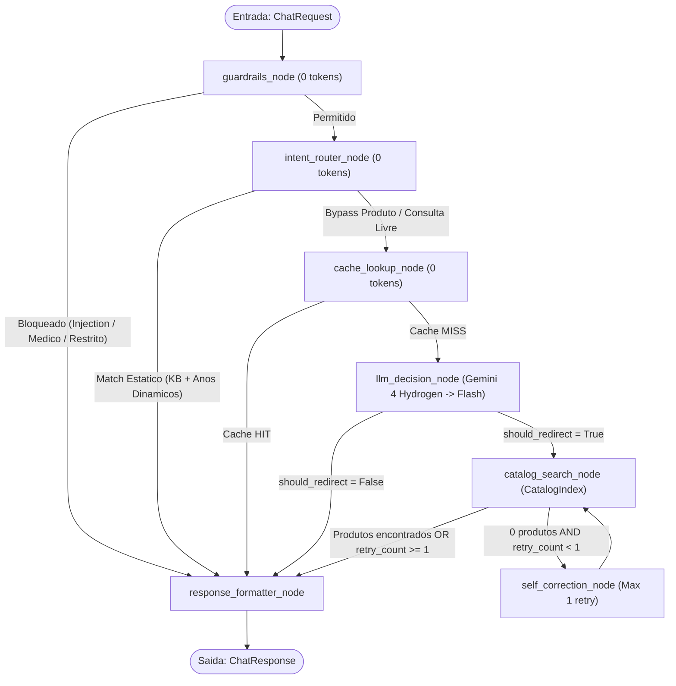

# Plano de Arquitetura e Implementação — LangGraph no Chatbot Fitoherb

> **Status:** Proposta Arquitetural (Estudo de Viabilidade + Blueprint Strangler Fig)  
> **Escopo:** Microsserviço `fitoherb-ai` (`app/domains/chat/`)  
> **Stack Alvo:** FastAPI · `google-genai` (`gemini-4-hydrogen` + fallback Flash) · `langgraph` · PostgreSQL (`AsyncPostgresSaver`) · Cloud Run (Scale-to-Zero)

---

## 1. Diagnóstico da Arquitetura Atual

O chatbot do `fitoherb-ai` opera hoje sobre uma **esteira linear determinística + LLM de turno único**, orquestrada em [`ChatOrchestrator`](file:///c:/Users/danie/Documents/Github/fitoherb-ai/app/domains/chat/services/chat_orchestrator.py):

| Camada / Componente | Arquivo | Responsabilidade Atual | Custo de Tokens |
| :--- | :--- | :--- | :--- |
| **Guardrails Determinísticos** | `services/guardrails_service.py` | Bloqueia Prompt Injection, aconselhamento médico (P-303) e consultas comerciais restritas de preço/estoque/tabela nutricional (P-302). Higieniza caracteres de controle e PII (`sanitize_pii`). | **0 tokens** |
| **IntentRouter Estático** | `services/intent_router.py` + `services/company_metrics.py` | Resolve saudações e fatos institucionais (localização, contato, redes sociais, cobertura e anos de mercado calculados automaticamente desde `01/11/1997`). Faz bypass imediato quando detecta menção a produtos (`PRODUCT_BYPASS_KEYWORDS`). | **0 tokens** |
| **Cache L1 em Memória** | `services/cache_service.py` | Cache SHA-256 normalizado com TTL de 3600s em memória do processo. | **0 tokens** |
| **Orquestrador Linear** | `services/chat_orchestrator.py` | Compacta histórico para as últimas 2 rodadas quando `len(history) >= 5` (P-307), chama o Gemini com Structured Output (`GeminiChatDecision`), consulta o catálogo e normaliza o texto final (P-306). | **~250–400 tokens** |
| **Cliente Gemini Oficial** | `infrastructure/gemini_client.py` | SDK `google-genai` com **`gemini-4-hydrogen`** como modelo principal e fallback automático para a família Flash (`gemini-3.8-flash`, `gemini-flash-latest`, `gemini-3.7-flash`, `gemini-3.6-flash`, `gemini-3.5-flash`, `gemini-3.5-flash-lite`). Compatibilidade nativa de `thinking_config` (`thinking_level="low"` ou omissão; nunca `thinking_budget=0` no Gemini 4). | Variável (1 chamada/turno) |
| **Índice de Catálogo** | `infrastructure/catalog_index.py` | Índice em memória carregado do PostgreSQL com normalização de acentos, sinônimos manuais, ranqueamento por tokens/sabores e diversificação de fornecedores (P-305 Neutralidade). | **0 tokens** |

### Limitações estruturais identificadas na esteira linear atual
1. **Ausência de autocorreção (`0 resultados`):** se `decision.catalog_search` gerado pela LLM não encontra nenhum produto em `CatalogIndex.search(...)`, o sistema redireciona o usuário com lista vazia sem tentar reformular a busca (ex.: remover adjetivos, expandir categoria ou relaxar sabor).
2. **Estado conversacional frágil:** depende do cliente reenviar `request.history` a cada chamada, sem `thread_id` persistido no backend.
3. **Cache L1 volátil e isolado por réplica:** em Cloud Run com Scale-to-Zero ou múltiplas instâncias, o dicionário em memória zera a cada cold start e não compartilha estado entre réplicas.
4. **Acoplamento para futuras ferramentas:** adicionar novas ações (ex.: localizar revendedor mais próximo, consultar status de pedido B2B, recomendar portfólio por canal farma/alimentar) exigiria múltiplos `if/else` encadeados no `ChatOrchestrator`.

---

## 2. Análise Crítica: Vale a pena implementar LangGraph?

### Tabela Comparativa: Esteira Linear Atual vs. LangGraph

| Dimensão | Arquitetura Atual (Linear) | Arquitetura com LangGraph | Impacto / Trade-off |
| :--- | :--- | :--- | :--- |
| **FinOps / Tokenomics** | Excelente: 100% dos guardrails, institucional e cache rodam em 0 tokens; LLM executa no máximo 1 chamada/turno. | Excelente se preservar nós determinísticos antes da LLM; adiciona **+1 chamada LLM somente no ramo de self-correction** (teto rígido de 1 retry). | Neutro no caminho feliz; +5% a +12% de tokens apenas em buscas difíceis (ganho direto em conversão). |
| **Cold Start (Cloud Run Scale-to-Zero)** | Baixíssimo (~350–600 ms); dependências leves (`fastapi`, `pydantic`, `google-genai`). | Acréscimo estimado de **+150 a +350 ms** no cold start se instalar apenas `langgraph` (sem `langchain-community` ou `langchain-google-genai`). | Aceitável se mantivermos **zero dependência de wrappers pesados do LangChain** e usarmos nosso `GeminiClient` direto. |
| **Latência (p95)** | ~600–1200 ms (1 chamada LLM + busca em memória). | ~620–1250 ms no caminho feliz (overhead do grafo < 15 ms); ~1400–2200 ms apenas quando aciona `self_correction_node`. | Negligenciável no caminho feliz. |
| **Complexidade de Código** | Baixa (~275 linhas em `chat_orchestrator.py`). Fácil de depurar. | Média (grafo declarativo, `TypedDict` state, checkpointer assíncrono, grafo de testes por nó). | Exige disciplina de estado imutável e testes de transição. |
| **Self-Correction e Multi-Tool** | Inexistente (exige `if/else` imperativo). | Nativo via arestas condicionais e ciclos controlados (`retry_count < 1`). | Grande vantagem competitiva ao evoluir o assistente. |
| **Memória Multi-Turno e Auditoria** | Dependente de `history` no payload do cliente. | Nativo via `Checkpointer` (`thread_id`), permitindo replay, inspeção de estado e retomada entre réplicas Cloud Run. | Essencial para jornadas B2B multi-turno. |

### Veredito Pragmático

> [!IMPORTANT]
> **Quando NÃO vale a pena migrar agora:**
> Se o chatbot permanecer restrito ao escopo atual (perguntas institucionais estáticas + busca de produto de turno único com redirecionamento para o catálogo), **migrar imediatamente para LangGraph traz complexidade desnecessária**. O `ChatOrchestrator` atual já cumpre 100% dos requisitos com custo mínimo de tokens e latência ótima.

> [!TIP]
> **Gatilhos objetivos em que PASSA a valer muito a pena ativar o LangGraph:**
> 1. **Taxa de buscas sem resultado (`products == []` em `PRODUCT_SEARCH`) > 10%** em produção — justificando o nó `self_correction_node` (teto de 1 retry) para reformular termos e recuperar vendas.
> 2. **Introdução de 2 ou mais ferramentas externas** (ex.: consulta de revendedores próximos, orçamento/pré-pedido B2B, status de entrega ou FAQ dinâmico com RAG).
> 3. **Necessidade de memória conversacional persistente por `thread_id`** (ex.: WhatsApp/Canal Comercial ou sessões web longas sem trafegar histórico completo no frontend).
> 4. **Requisitos de Human-in-the-Loop (HITL)** (ex.: escalonamento assistido para vendedor humano com contexto resumido).

---

## 3. Arquitetura Alvo com LangGraph

### 3.1 Fluxo do Grafo (Nós e Arestas Condicionais)



### 3.2 Definição do Estado (`ChatGraphState`)

```python
from typing import Annotated, Any, Dict, List, Optional, TypedDict
from langgraph.graph.message import add_messages


class ChatGraphState(TypedDict):
    # Histórico conversacional gerenciado pelo reducer oficial do LangGraph
    messages: Annotated[List[Any], add_messages]

    # Entrada normalizada e metadados da requisição
    thread_id: str
    user_message: str
    sanitized_message: str

    # Controle de curto-circuito determinístico (0 tokens)
    blocked: bool
    block_reason: Optional[str]
    static_matched: bool
    cache_hit: bool
    cached_payload: Optional[Dict[str, Any]]

    # Decisão estruturada da LLM (GeminiChatDecision)
    intent: str
    reply: str
    should_redirect: bool
    catalog_search: str
    category_slug: Optional[str]
    supplier_slug: Optional[str]

    # Resultado de catálogo e controle estrito de Self-Correction
    products: List[Dict[str, Any]]
    retry_count: int          # Teto obrigatório: MAX_CATALOG_RETRIES = 1
    previous_queries: List[str]

    # Observabilidade & FinOps
    model_used: str
    cache_status: str         # "STATIC_KB" | "HIT" | "MISS" | "GUARDRAIL"
    prompt_tokens: int
    completion_tokens: int
```

### 3.3 Reaproveitamento do `GeminiClient` Oficial (`google-genai`)

**Decisão arquitetural:** **NÃO** instalar `langchain-google-genai`. Os nós `llm_decision_node` e `self_correction_node` devem injetar e invocar diretamente a instância de [`GeminiClient`](file:///c:/Users/danie/Documents/Github/fitoherb-ai/app/domains/chat/infrastructure/gemini_client.py):

- **Preservação do Fallback Oficial:** mantém a cadeia `gemini-4-hydrogen` -> `gemini-3.8-flash` -> `gemini-flash-latest` -> `gemini-3.7-flash` -> `gemini-3.6-flash` -> `gemini-3.5-flash` -> `gemini-3.5-flash-lite` sem reescrever lógica de resiliência.
- **Compatibilidade de `ThinkingConfig`:** preserva `_build_thinking_config`, garantindo que `thinking_budget=0` nunca seja enviado ao Gemini 4 Hydrogen.
- **Structured Output nativo:** continua utilizando `response_schema=GeminiChatDecision` via `google-genai` com zero overhead de conversão LangChain.
- **FinOps / Cold Start:** mantém a imagem Docker enxuta (`python:3.11-slim`), adicionando apenas `langgraph` (pacote leve em Python puro) e, quando ativada persistência, `langgraph-checkpoint-postgres`.

### 3.4 Estratégia de Persistência e Checkpointer (Cloud Run Stateless)

Para manter o serviço 100% compatível com **Cloud Run Scale-to-Zero** (sem estado em disco local nem afinidade de instância):

1. **Desenvolvimento e Testes Automatizados (`ENV=dev|test`):**
   - Utilizar `MemorySaver` (em memória) para execução instantânea e isolada em testes TDD sem dependência de banco.
2. **Staging e Produção (`ENV=staging|prod`):**
   - Utilizar `AsyncPostgresSaver` conectado ao banco PostgreSQL compartilhado (schema dedicado `langgraph_checkpoints` para não poluir as tabelas de domínio da Fitoherb).
   - **Governança LGPD (Privacy by Design):**
     - Passar todo texto por `GuardrailsService.sanitize_pii` **antes** de persistir no `ChatGraphState`.
     - Aplicar job/política de retenção (TTL de **24h a 7 dias**) para expirar checkpoints antigos de `thread_id` anônimos, evitando acúmulo de dados desnecessários e mantendo custo de storage próximo de zero.

---

## 4. Plano de Implementação Faseado (Strangler Fig)

A migração será protegida pela variável de ambiente **`CHAT_ENGINE=legacy|langgraph`** (padrão inicial: `legacy`), permitindo coexistência segura, testes A/B em staging e rollback instantâneo sem redeploy de código.

### Fase 1 — Fundação do Grafo e Paridade Funcional (MVP Shadow/Toggle)
- **Entregáveis:**
  - Adicionar `langgraph` em `requirements.txt` (sem `langchain-google-genai`).
  - Criar `app/domains/chat/graph/state.py` (`ChatGraphState`), `app/domains/chat/graph/nodes.py` (reaproveitando `GuardrailsService`, `IntentRouter`, `ConversationCacheService`, `CatalogIndex` e `GeminiClient`) e `app/domains/chat/graph/builder.py`.
  - Criar fábrica `ChatEngineFactory` controlada por `CHAT_ENGINE=legacy|langgraph` expondo a mesma assinatura `process_message(request: ChatRequest) -> ChatResponse`.
- **Critério de Saída (TDD):** 100% dos testes existentes em `tests/test_chat_assistant.py` e `tests/test_gemini_client_and_years.py` passando nos dois engines (`legacy` e `langgraph`).

### Fase 2 — Nó de Self-Correction Controlado (Teto de 1 Retry)
- **Entregáveis:**
  - Implementar `self_correction_node` acionado exclusivamente quando `should_redirect == True`, `len(products) == 0` e `retry_count < 1`.
  - Prompt enxuto enviado ao `GeminiClient` com a query original + lista de categorias/fornecedores válidos para gerar uma única query alternativa mais ampla (ex.: `"whey isolado sabor pistache zero lactose"` -> `"whey isolado"`).
  - Trava determinística (`retry_count += 1`) impossibilitando loops infinitos ou explosão de custo de tokens.
- **Critério de Saída (TDD):** testes unitários validando (a) recuperação bem-sucedida no 1º retry, (b) encerramento garantido após 1 retry mesmo se continuar com 0 resultados, e (c) 0 retries quando o catálogo retorna resultados de primeira.

### Fase 3 — Persistência Stateless (`AsyncPostgresSaver`) e `thread_id`
- **Entregáveis:**
  - Adicionar `thread_id: Optional[str]` (retrocompatível) em `ChatRequest`.
  - Configurar `AsyncPostgresSaver` em `staging`/`prod` com `MemorySaver` em `dev`/`test`.
  - Aplicar sanitização de PII pré-checkpoint e rotina de limpeza por TTL.
- **Critério de Saída (TDD):** testes de continuidade multi-turno restaurando estado via `thread_id` entre duas instâncias distintas do grafo, validando ausência de CPF/PII nos checkpoints.

### Fase 4 — Rollout Gradual, Observabilidade e Descomissionamento
- **Entregáveis:**
  - Instrumentação JSON estruturada por nó (`node_latency_ms`, `engine`, `model_used`, `retry_triggered`, `zero_results`).
  - Ativação progressiva via `CHAT_ENGINE=langgraph` em staging -> produção.
  - Remoção do caminho `legacy` somente após 14 dias consecutivos dentro das metas.

### Métricas de Sucesso (KPIs)

| Métrica | Linha de Base (Meta Atual) | Meta com LangGraph | Critério de Alerta / Rollback |
| :--- | :--- | :--- | :--- |
| **Taxa de Resolução em 0 Tokens** (Guardrails + Static KB + Cache) | >= 45% das interações | Manter >= 45% (sem regressão) | Queda > 5 p.p. |
| **Latência p95 (Caminho Feliz)** | <= 1.200 ms | <= 1.350 ms | > 2.000 ms sustentado |
| **Taxa de `0 resultados` em `PRODUCT_SEARCH`** | Baseline a medir em prod | Redução >= 30% via `self_correction_node` | Sem melhora após 14 dias |
| **Custo de Tokens por 1.000 turnos** | Baseline `gemini-4-hydrogen` | Acréscimo máximo <= 10% | Acréscimo > 20% |
| **Cold Start Cloud Run** | ~500 ms | <= 900 ms | > 1.500 ms |

### Plano de Rollback Instantâneo
1. **Nível 1 (< 30 segundos, sem build):** alterar a variável de ambiente no Cloud Run para `CHAT_ENGINE=legacy` e redirecionar 100% do tráfego para a revisão anterior/atualizada.
2. **Nível 2 (Fallback de persistência):** caso o PostgreSQL de checkpoints fique indisponível, degradar automaticamente para execução stateless sem checkpointer (`checkpointer=None`) usando `request.history`, mantendo o chatbot 100% operacional.
