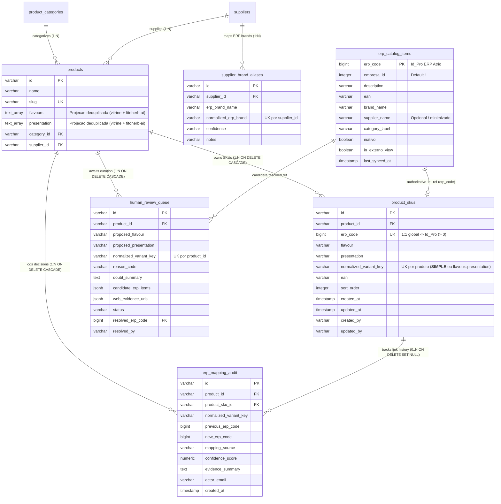

# Documentação de Banco de Dados: Mapeamento de Código ERP por SKU, Sabores/Apresentações e Sincronização Prod → Local

> **Localização Mandatória:** `.agents/docs/db/product_code_mapping_flavors.md`  
> **Responsável:** DBA (`dba-expert`)  
> **Referências de Regras:** `.agents/rules/backend-db-performance-rules.md`, `.agents/docs/business_rules/product_code_mapping_flavors.md`, `.agents/docs/GLOSSARY.md`

---

## 1. Visão Geral do Módulo

- **Domínio de Negócio:** Governança de Catálogo & Integração ERP Atrio (`Product`, `ProductSku`, + Staging Temporário Local em `US-P1`) — Épico 3 (`P-400` a `P-409`, Diretriz `A1`).
- **Propósito:** Estruturar no banco PostgreSQL do site (`products` + `product_skus`, **sem manter tabelas espelho ERP permanentes após a sincronização conforme decisão `A1`**) a rastreabilidade **1:1** entre cada **SKU de Produto (`ProductSku`)** comercializado no site `fitoherb-v2` (simples, somente sabor, somente apresentação ou matriz esparsa sabor × apresentação) e seu respectivo **Código ERP (`erp_code` / `Id_Pro`)** no ERP Atrio (`FITOHERB`), preservando `products.flavours` e `products.presentation` como projeção saneada e deduplicada para a vitrine pública e o `CatalogIndex` (`fitoherb-ai`). As tabelas auxiliares `erp_catalog_items`, `supplier_brand_aliases`, `human_review_queue` e `erp_mapping_audit` são usadas **exclusivamente como staging temporário local durante `US-P1`** e removidas via `DROP TABLE` ao término da curadoria local.
- **Mecanismo de Persistência:** PostgreSQL 17/18 (`fitoherb-v2` local e Supabase em produção), integrado via Spring Boot 4.0.5 / Spring Data JPA (`products` e `product_skus` somente). Em runtime, a validação e busca contra o catálogo do ERP Atrio operam diretamente contra o SQL Server 2008 R2 (`FITOHERB`) em modo somente leitura via `jtds` + cache em memória RAM (`ADR-005`).
- **Origem Externa (Linhagem de Dados / Data Lineage):**
  - **Fonte autoritativa ERP:** SQL Server 2008 R2 (`FITOHERB`) — `[dbo].[Produtos]` (`Empresa_Pro = 1`, `PK (Empresa_Pro, Id_Pro)`) e `[Externo01].[Produto]`.
  - **Destino Permanente no PostgreSQL (`fitoherb-v2` e Produção):** Apenas `product_skus` + projeção saneada em `products.flavours` / `products.presentation` → consumido em leitura pública por `ProductRes` (vitrine) e `CatalogIndex` (`fitoherb-ai`). *(O espelho `erp_catalog_items` existe somente durante o clone/curadoria local e é removido depois — `A1`.)*
- **Nota Operacional de Ambiente (Sessão Etapa 2):** Durante a modelagem, o servidor MCP `postgres` (`query`) não pôde ser consultado porque `.agents/mcp_config.json` aponta para credencial placeholder (`user@localhost/mydb` — erro `autenticação do tipo senha falhou para o usuário "user"`). A estrutura atual foi verificada diretamente nas entidades JPA (`Product.java`, `Supplier.java`, `ProductCategory.java`, `User.java`, `Banner.java`), `DatabaseConstraintInitializer.java`, `application*.properties` e workflows `backup.yml`/`restore.yml`.

### 1.1. Diagrama Entidade-Relacionamento (ER)



### 1.2. Classificação LGPD, Minimização de Dados e Segregação (`P-408`)

> [!IMPORTANT]
> Códigos `Id_Pro`, `EAN`, descrições de mercadorias, sabores e gramaturas são dados cadastrais comerciais (não constituem dados pessoais de pessoas físicas). Contudo, existem **dois vetores de conformidade** obrigatórios:
> 1. **Operadores Internos (LGPD Art. 7º, V e IX):** Colunas `created_by`, `updated_by`, `resolved_by` e `actor_email` armazenam o e-mail do usuário autenticado via `AuditorAwareImpl` (ou `"SYSTEM"`). **Jamais** devem ser expostas em endpoints públicos (`/products/gallery`), no `fitoherb-ai` (`CatalogIndex`), nem impressas em logs irrestritos.
> 2. **Minimização Comercial (`P-302`, `P-408`):** Campos sensíveis do ERP Atrio — especialmente `[Externo01].[Produto].Estoque`, preços de venda, custos de compra, margens e CNPJs/dados fiscais de atacadistas — são **terminantemente excluídos** da importação para o PostgreSQL.

#### Avaliação de Minimização: `erp_catalog_items.supplier_name`
- No ERP Atrio (`FITOHERB`), `Marca_Pro` (`Nome_Marc`) representa a **marca comercial de catálogo** (ex.: `MAX TITANIUM`, `GUARANAPIS`, `BLACK SKULL`), enquanto `fornec_pro` (`Nome_For`) pode representar a razão social de um fornecedor/atacadista/distribuidor de compra.
- **Diretriz DBA + Privacy by Design:**
  - **Recomendação Primária (Minimização Máxima):** Priorizar `brand_name` (`Nome_Marc`) como campo obrigatório de busca/matching e **não importar razões sociais confidenciais de fornecedores de compra** em `supplier_name`.
  - **Uso Restrito de `supplier_name` (Nullable):** Manter a coluna `supplier_name VARCHAR(120) NULL` no DDL apenas caso o ERP possua itens com `Marca_Pro` vazia onde `[Externo01].[Fornecedor]` atue como rótulo de fabricante público (ou sujeito à validação no Checkpoint com o Privacy Officer), bloqueando qualquer exposição pública (`P-408`).

---

## 2. Estrutura de Tabelas

### 2.0. Tabela Existente Preservada: `products` (Sem Alteração Destrutiva)
- **Compatibilidade com Produção e `fitoherb-ai`:**
  - `id` real em PostgreSQL (gerado por Hibernate `ddl-auto=update` sem `length=36`) é `VARCHAR(255) PRIMARY KEY`. Portanto, todas as FKs deste módulo que referenciam `products(id)` ou `suppliers(id)` utilizam `VARCHAR(255)` para evitar divergência de tipo com Hibernate.
  - **`flavours` (`VARCHAR(255)[]`) e `presentation` (`VARCHAR(255)[]`) NÃO são removidas.** Elas passam a ser mantidas pela camada de serviço como **projeção atômica, higienizada, ordenada e deduplicada** a partir de `product_skus` (`P-401`), preservando 100% da vitrine pública e da query direta do `CatalogIndex` (`fitoherb-ai`).
  - **Cálculo do `ErpMappingStatus` (`US-P6`):** Em vez de adicionar uma coluna denormalizada em `products` (que ficaria obsoleta sempre que `erp_catalog_items.inativo` mudasse na sincronização), o status (`UNMAPPED`, `COMPLETE`, `INACTIVE_ALERT`) é avaliado dinamicamente via joins indexados em `product_skus` + `erp_catalog_items` (com suporte opcional de uma View SQL `v_product_erp_governance` para auditoria/admin).
  - *(Nota Q-04)*: Caso no Checkpoint seja aprovada a exceção `"Sem vínculo ERP (Apenas Institucional)"`, poderá ser adicionada posteriormente uma coluna aditiva `erp_exempt BOOLEAN NOT NULL DEFAULT FALSE` + `erp_exempt_reason VARCHAR(255)` sem impacto destrutivo.

---

### 2.1. Tabela: `product_skus`
- **Descrição de Negócio:** Representa cada **SKU de Produto** comercializável vinculado a um `Product`, garantindo o vínculo **1:1** entre a unidade física do site (simples, somente sabor, somente apresentação ou matriz sabor × apresentação) e seu código autoritativo `Id_Pro` no ERP Atrio (`P-402`, `P-404`, `P-405`).

| Coluna | Tipo Primitivo | Nulo? | Padrão (Default) | Classificação LGPD | Descrição / Regra |
| :--- | :--- | :--- | :--- | :--- | :--- |
| `id` | `VARCHAR(255)` | `NOT NULL` | UUID v4 (JPA) | Dado Cadastral (Não Pessoal) | Chave primária identificadora (`GenerationType.UUID`) |
| `product_id` | `VARCHAR(255)` | `NOT NULL` | `N/A` | Dado Cadastral (Não Pessoal) | FK para `products(id)` (`ON DELETE CASCADE`) |
| `erp_code` | `BIGINT` | `NOT NULL` | `N/A` | Dado Corporativo Interno (`P-408`) | Código `Id_Pro` único no catálogo do site (`> 0`) |
| `flavour` | `VARCHAR(100)` | `NULL` | `NULL` | Dado Cadastral Público | Sabor atômico higienizado (`NULL` em Simples / Só Apresentação) |
| `presentation` | `VARCHAR(100)` | `NULL` | `NULL` | Dado Cadastral Público | Apresentação/gramatura higienizada (`NULL` em Simples / Só Sabor) |
| `normalized_variant_key` | `VARCHAR(220)` | `NOT NULL` | `N/A` | Dado Cadastral (Não Pessoal) | Chave canônica normalizada da variação dentro do produto (`'__SIMPLE__'` ou `'sabor_norm::apres_norm'`) |
| `ean` | `VARCHAR(20)` | `NULL` | `NULL` | Dado Corporativo Interno (`P-408`) | Código de barras (`codbarra_pro`) espelhado para exibição/busca admin |
| `sort_order` | `INTEGER` | `NOT NULL` | `0` | Dado Cadastral (Não Pessoal) | Ordem determinística de exibição e projeção para `products` |
| `erp_inactive` | `BOOLEAN` | `NOT NULL` | `FALSE` | Governança ERP (`P-406`, `A1`) | Último estado conhecido de `inativo_pro` no ERP (dispensa tabela espelho em PostgreSQL) |
| `erp_inactive_confirmed` | `BOOLEAN` | `NOT NULL` | `FALSE` | Governança ERP (`P-406`) | Registra aceite explícito de vínculo para SKU com `inativo = true` |
| `erp_last_verified_at` | `TIMESTAMP` | `NULL` | `NULL` | Auditoria Técnica (`P-403`) | Timestamp da última verificação direta contra o catálogo ERP em RAM / SQL Server |
| `created_at` | `TIMESTAMP` | `NOT NULL` | `NOW()` | Auditoria Técnica | Timestamp de criação (`@CreatedDate`, imutável) |
| `updated_at` | `TIMESTAMP` | `NULL` | `NULL` | Auditoria Técnica | Timestamp da última modificação (`@LastModifiedDate`) |
| `created_by` | `VARCHAR(255)` | `NULL` | `NULL` | Dado Pessoal (Operador Interno) | E-mail do operador criador ou `"SYSTEM"` (`@CreatedBy`) |
| `updated_by` | `VARCHAR(255)` | `NULL` | `NULL` | Dado Pessoal (Operador Interno) | E-mail do último operador modificador (`@LastModifiedBy`) |

#### Regra Determinística de `normalized_variant_key`
Para impedir duplicatas por maiúsculas, acentos, espaços extras ou `NULL`s equivalentes em SQL (`P-404`):
- **Produto Simples** (`flavour IS NULL AND presentation IS NULL`): `'__SIMPLE__'`
- **Somente Sabor** (`flavour = 'Baunilha'`, `presentation IS NULL`): `'baunilha::'`
- **Somente Apresentação** (`flavour IS NULL`, `presentation = '25ml'`): `'::25ml'`
- **Matriz Sabor × Apresentação** (`flavour = 'Limão'`, `presentation = '150g'`): `'limao::150g'`

#### Relacionamentos e Chaves Estrangeiras (Foreign Keys)
- `fk_product_skus_product`: `product_id` referencia `public.products(id)` com **`ON DELETE CASCADE`**.
  - *Justificativa:* A exclusão administrativa de um `Product` (`deleteProductBySlug`) remove atomicamente seus SKUs, liberando os respectivos `erp_code`s sem registros órfãos.
- *Nota sobre vínculo com `erp_catalog_items(erp_code)`:* Opta-se por **validação aplicacional contra `erp_catalog_items`** (`P-403`) sem `FK` rígida bloqueante de exclusão sobre `erp_catalog_items`, para que futuras re-sincronizações ou inativações extremas no ERP jamais quebrem ou impeçam a leitura de produtos já publicados (`P-406`). (Opcionalmente pode-se usar FK `ON DELETE RESTRICT` caso o espelho seja estritamente *upsert-only* e nunca delete registros antigos).

#### Constraints & Validações de Domínio
- **Primary Key:** `pk_product_skus` em `(id)`
- **Unique Key (Global 1:1 `P-404`):** `uk_product_skus_erp_code` em `(erp_code)` *(NÃO `DEFERRABLE` — requisito obrigatório do PostgreSQL para permitir backfill idempotente via `INSERT ... ON CONFLICT (erp_code)`! Trocas de código entre variações do mesmo produto em `PUT /products/{slug}` devem ser reconciliadas pelo Service via remoção/flush ordenado antes dos novos valores).*
- **Unique Key (Variação por Produto `P-404`):** `uk_product_skus_product_variant` em `(product_id, normalized_variant_key)`
- **Check Constraints:**
  - `chk_product_skus_erp_code_positive`: `CHECK (erp_code > 0)`
  - `chk_product_skus_sort_order_non_negative`: `CHECK (sort_order >= 0)`
  - `chk_product_skus_flavour_not_blank`: `CHECK (flavour IS NULL OR char_length(btrim(flavour)) > 0)`
  - `chk_product_skus_presentation_not_blank`: `CHECK (presentation IS NULL OR char_length(btrim(presentation)) > 0)`
  - `chk_product_skus_variant_key_not_blank`: `CHECK (char_length(btrim(normalized_variant_key)) > 0)`
  - `chk_product_skus_simple_key_consistency`: `CHECK (((flavour IS NULL AND presentation IS NULL) AND normalized_variant_key = '__SIMPLE__') OR ((flavour IS NOT NULL OR presentation IS NOT NULL) AND normalized_variant_key <> '__SIMPLE__'))`
- *Nota sobre Topologia (`P-405`):* A consistência **entre linhas** do mesmo produto (ex.: não misturar `'__SIMPLE__'` com variações, nem misturar `"somente sabor"` com `"matriz"`) é validada transacionalmente em `ProductService`, evitando locks de triggers em atualizações em lote.

### 2.0b. Evolução Aditiva Idempotente da Tabela `products` (`US-P7` / `US-P8` — `P-411` a `P-413`)
- **Preservação Integral de Legados (`1.032` produtos no clone prod):** Todas as linhas existentes em `products` recebem `active = TRUE` e `curation_status = 'COMPLETED'`, nunca ocultando nada na migração de DDL (`A3`) e mantendo `image_path` nullable (`Product.java`) para publicação imediata sem foto (`P-412`).
- **`active` (`BOOLEAN NOT NULL DEFAULT TRUE`):** Visibilidade pública na Vitrine e `CatalogIndex`; índice parcial `idx_products_active` `ON public.products (name) WHERE active = TRUE`.
- **`curation_status` (`VARCHAR(20) NOT NULL DEFAULT 'COMPLETED'`):** `'COMPLETED'`, `'PENDING_IMAGE'`, `'IGNORED'` (`chk_products_curation_status`); índice parcial `idx_products_curation_pending` `ON public.products (active, created_at DESC) WHERE curation_status = 'PENDING_IMAGE'`.
- **Proteção Transitória Legada (`A3`):** Sync diário só recalcula `active` de produtos com `>= 1` SKU (ou `'IGNORED'`), preservando legados `UNMAPPED` até fim do backfill.

#### Índices e Otimização de Performance
- `uk_product_skus_erp_code` (B-Tree único implícito em `erp_code`): busca instantânea $O(\log N)$ na validação de conflito (`P-404`) e busca administrativa por `Id_Pro` (`P-408`).
- `uk_product_skus_product_variant` (B-Tree único implícito em `(product_id, normalized_variant_key)`).
- `idx_product_skus_product_id_sort`: B-Tree composto em `(product_id, sort_order, id)` — indexa obrigatoriamente a FK `product_id` (evitando *table lock* / *full scan* em exclusões e joins N+1) e entrega SKUs já ordenados para projeção.
- `idx_product_skus_ean`: B-Tree parcial `WHERE ean IS NOT NULL` em `(ean)`.

---

### 2.2. a 2.5. Tabelas de Staging Temporário Local (`US-P1` — Removidas pós-Sync conforme `A1`)

> [!IMPORTANT]
> **Regra Mandatória `A1`:** As tabelas `erp_catalog_items`, `supplier_brand_aliases`, `human_review_queue` e `erp_mapping_audit` abaixo destinam-se **EXCLUSIVAMENTE ao processo temporário de clonagem e sincronização/curadoria local (`US-P1`)**. Ao concluir o preenchimento de `product_skus`, todas são **removidas do banco PostgreSQL `fitoherb-v2` via `DROP TABLE`** (`Step Limpeza A1`) e **nunca** são criadas no banco de Produção. Em runtime, aliases vivem em configuração YAML e buscas/validações usam SQL Server read-only + cache RAM.

#### 2.2. Tabela Temporária de Curadoria: `erp_catalog_items` *(Drop pós-US-P1)*
- **Descrição de Negócio:** Espelho temporário no PostgreSQL local durante `US-P1` dos itens do ERP Atrio (`Empresa_Pro = 1`, consolidando `[dbo].[Produtos]` e presença em `[Externo01].[Produto]`), usado para matching em 3 níveis e separação da lista de inativos (`A2`).

| Coluna | Tipo Primitivo | Nulo? | Padrão (Default) | Classificação LGPD | Descrição / Regra |
| :--- | :--- | :--- | :--- | :--- | :--- |
| `erp_code` | `BIGINT` | `NOT NULL` | `N/A` | Dado Corporativo Interno (`P-408`) | Chave primária (`Id_Pro` em `[dbo].[Produtos]`, `> 0`) |
| `empresa_id` | `INTEGER` | `NOT NULL` | `1` | Dado Corporativo Interno | Empresa no ERP (`Empresa_Pro = 1`) |
| `description` | `VARCHAR(255)` | `NOT NULL` | `N/A` | Dado Corporativo Interno | Descrição oficial no ERP (`descricao_pro`) |
| `ean` | `VARCHAR(20)` | `NULL` | `NULL` | Dado Corporativo Interno | Código de barras (`codbarra_pro`) higienizado |
| `brand_name` | `VARCHAR(120)` | `NULL` | `NULL` | Dado Corporativo Interno | Nome da marca/fabricante no ERP (`Nome_Marc`) |
| `supplier_name` | `VARCHAR(120)` | `NULL` | `NULL` | Dado Comercial Restrito *(Minimização)* | Opcional/nulo por padrão; usar apenas rótulo de marca quando `brand_name` ausente (nunca atacadista confidencial) |
| `category_label` | `VARCHAR(100)` | `NULL` | `NULL` | Dado Corporativo Interno | Grupo/categoria no ERP para contexto de matching |
| `inativo` | `BOOLEAN` | `NOT NULL` | `FALSE` | Dado Corporativo Interno (`P-406`) | Espelha `[dbo].[Produtos].inativo_pro` (`1` → `true`) |
| `in_externo_view` | `BOOLEAN` | `NOT NULL` | `FALSE` | Dado Corporativo Interno (`P-406`) | Indica se o `Id_Pro` consta na view `[Externo01].[Produto]` |
| `last_synced_at` | `TIMESTAMP` | `NOT NULL` | `NOW()` | Auditoria Técnica | Data/hora da última sincronização com o ERP Atrio |

#### Constraints & Validações de Domínio
- **Primary Key:** `pk_erp_catalog_items` em `(erp_code)`
- **Check Constraints:**
  - `chk_erp_catalog_items_erp_code_positive`: `CHECK (erp_code > 0)`
  - `chk_erp_catalog_items_empresa_positive`: `CHECK (empresa_id > 0)`
  - `chk_erp_catalog_items_desc_not_blank`: `CHECK (char_length(btrim(description)) > 0)`

#### Índices e Otimização de Performance
- `pk_erp_catalog_items` (B-Tree em `erp_code`): lookup exato em <1ms (`P-403`).
- `idx_erp_catalog_items_erp_code_prefix`: B-Tree em `((erp_code::text) text_pattern_ops)` para busca incremental por prefixo digitado pelo operador (ex.: `1314%`).
- `idx_erp_catalog_items_ean`: B-Tree parcial `WHERE ean IS NOT NULL` em `(ean)` para leitura exata/prefixo de código de barras.
- `idx_erp_catalog_items_inativo_externo`: B-Tree composto em `(inativo, in_externo_view)` para filtros e detecção de `INACTIVE_ALERT`.
- `idx_erp_catalog_items_desc_trgm`: **GIN Trigram** sobre função `IMMUTABLE` de normalização sem acentos `public.fitoherb_normalize_text(description) gin_trgm_ops` (extensão `pg_trgm`). Acelera `ILIKE '%whey choc%'` e buscas fuzzy nos 6.946+ registros sem *Full Table Scan*.
- `idx_erp_catalog_items_brand_trgm`: **GIN Trigram** sobre `public.fitoherb_normalize_text(brand_name) gin_trgm_ops` para busca cross-brand (`GUARANAPIS`, `MAX TITANIUM`, etc.).

---

### 2.3. Tabela: `supplier_brand_aliases`
- **Descrição de Negócio:** Dicionário de equivalência entre o nome do Fornecedor/Marca no site (`suppliers`) e os nomes de marca registrados no ERP Atrio (ex.: `Arrebite` ↔ `GUARANAPIS`), usado na busca ampla (`P-407`) e no matching assistido (`P-409`).

| Coluna | Tipo Primitivo | Nulo? | Padrão (Default) | Classificação LGPD | Descrição / Regra |
| :--- | :--- | :--- | :--- | :--- | :--- |
| `id` | `VARCHAR(255)` | `NOT NULL` | UUID v4 (JPA) | Dado Cadastral (Não Pessoal) | Chave primária identificadora |
| `supplier_id` | `VARCHAR(255)` | `NOT NULL` | `N/A` | Dado Cadastral (Não Pessoal) | FK para `public.suppliers(id)` (`ON DELETE CASCADE`) |
| `erp_brand_name` | `VARCHAR(120)` | `NOT NULL` | `N/A` | Dado Corporativo Interno | Nome original da marca no ERP Atrio (ex.: `'GUARANAPIS'`) |
| `normalized_erp_brand` | `VARCHAR(120)` | `NOT NULL` | `N/A` | Dado Corporativo Interno | Versão normalizada (`lower`, sem acentos, `trim`) para match exato |
| `confidence` | `VARCHAR(20)` | `NOT NULL` | `'CONFIRMED'` | Governança de Dados | `CONFIRMED`, `AUTO_SUGGESTED`, `DEPRECATED` |
| `notes` | `VARCHAR(500)` | `NULL` | `NULL` | Governança de Dados | Justificativa da equivalência (evidência de catálogo/NF) |
| `created_at` | `TIMESTAMP` | `NOT NULL` | `NOW()` | Auditoria Técnica | Timestamp de criação |
| `updated_at` | `TIMESTAMP` | `NULL` | `NULL` | Auditoria Técnica | Timestamp de atualização |
| `created_by` | `VARCHAR(255)` | `NULL` | `NULL` | Dado Pessoal (Operador Interno) | Operador criador ou `"SYSTEM"` |
| `updated_by` | `VARCHAR(255)` | `NULL` | `NULL` | Dado Pessoal (Operador Interno) | Último operador modificador |

#### Relacionamentos, Constraints & Índices
- `fk_supplier_brand_aliases_supplier`: `supplier_id` → `public.suppliers(id)` `ON DELETE CASCADE`.
- `uk_supplier_brand_aliases_pair`: `UNIQUE (supplier_id, normalized_erp_brand)`.
- `chk_supplier_brand_aliases_confidence`: `CHECK (confidence IN ('CONFIRMED', 'AUTO_SUGGESTED', 'DEPRECATED'))`.
- `chk_supplier_brand_aliases_brand_not_blank`: `CHECK (char_length(btrim(erp_brand_name)) > 0 AND char_length(btrim(normalized_erp_brand)) > 0)`.
- `idx_supplier_brand_aliases_supplier_id`: B-Tree em `(supplier_id)` *(índice obrigatório na FK)*.
- `idx_supplier_brand_aliases_norm_brand`: B-Tree em `(normalized_erp_brand)` para lookup reverso ERP → Site.

---

### 2.4. Tabela: `human_review_queue`
- **Descrição de Negócio:** Fila estruturada de curadoria humana para itens do legado que, após matching determinístico e pesquisa web (`US-P1`, `P-409`), permanecerem com 0 candidatos, múltiplos candidatos (ex.: `UN` vs `DISP.`) ou apenas inativos incertos — garantindo estrito cumprimento do protocolo **"Zero Chutes"**.

| Coluna | Tipo Primitivo | Nulo? | Padrão (Default) | Classificação LGPD | Descrição / Regra |
| :--- | :--- | :--- | :--- | :--- | :--- |
| `id` | `VARCHAR(255)` | `NOT NULL` | UUID v4 (JPA) | Dado Cadastral (Não Pessoal) | Chave primária |
| `product_id` | `VARCHAR(255)` | `NOT NULL` | `N/A` | Dado Cadastral (Não Pessoal) | FK para `public.products(id)` (`ON DELETE CASCADE`) |
| `proposed_flavour` | `VARCHAR(100)` | `NULL` | `NULL` | Dado Cadastral | Sabor saneado candidato |
| `proposed_presentation` | `VARCHAR(100)` | `NULL` | `NULL` | Dado Cadastral | Apresentação saneada candidata |
| `normalized_variant_key` | `VARCHAR(220)` | `NOT NULL` | `N/A` | Dado Cadastral | Chave normalizada da variação ou `'__SIMPLE__'` |
| `reason_code` | `VARCHAR(40)` | `NOT NULL` | `N/A` | Governança de Curadoria | Motivo do encaminhamento à fila humana |
| `doubt_summary` | `TEXT` | `NOT NULL` | `N/A` | Governança de Curadoria | Descrição objetiva da dúvida para decisão do usuário |
| `candidate_erp_items` | `JSONB` | `NOT NULL` | `'[]'::jsonb` | Dado Corporativo Interno | Top candidatos ERP (`erp_code`, `description`, `ean`, `brand_name`, `inativo`, `in_externo_view`, `score`) |
| `web_evidence_urls` | `JSONB` | `NOT NULL` | `'[]'::jsonb` | Governança de Curadoria | Fontes oficiais consultadas na pesquisa web (`Nível 2`) |
| `status` | `VARCHAR(20)` | `NOT NULL` | `'PENDING'` | Governança de Curadoria | `PENDING`, `APPROVED`, `SKIPPED_OBSOLETE`, `REJECTED` |
| `resolved_erp_code` | `BIGINT` | `NULL` | `NULL` | Dado Corporativo Interno | Código `Id_Pro` escolhido na decisão humana (FK opcional → `erp_catalog_items`) |
| `resolution_notes` | `VARCHAR(500)` | `NULL` | `NULL` | Governança de Curadoria | Observação registrada na aprovação/descarte |
| `resolved_at` | `TIMESTAMP` | `NULL` | `NULL` | Auditoria Técnica | Timestamp da decisão |
| `resolved_by` | `VARCHAR(255)` | `NULL` | `NULL` | Dado Pessoal (Operador Interno) | E-mail do operador que decidiu |
| `created_at` | `TIMESTAMP` | `NOT NULL` | `NOW()` | Auditoria Técnica | Timestamp de criação |
| `updated_at` | `TIMESTAMP` | `NULL` | `NULL` | Auditoria Técnica | Timestamp de atualização |
| `created_by` | `VARCHAR(255)` | `NULL` | `NULL` | Dado Pessoal (Operador Interno) | Criador (`"SYSTEM"` / e-mail) |
| `updated_by` | `VARCHAR(255)` | `NULL` | `NULL` | Dado Pessoal (Operador Interno) | Modificador |

#### Relacionamentos, Constraints & Índices
- `fk_human_review_queue_product`: `product_id` → `public.products(id)` `ON DELETE CASCADE`.
- `fk_human_review_queue_resolved_erp`: `resolved_erp_code` → `public.erp_catalog_items(erp_code)` `ON DELETE SET NULL`.
- `uk_human_review_queue_product_variant`: `UNIQUE (product_id, normalized_variant_key)`.
- `chk_hrq_reason_code`: `CHECK (reason_code IN ('NO_CANDIDATE', 'MULTIPLE_CANDIDATES', 'PACKAGING_AMBIGUITY', 'INACTIVE_ONLY_CANDIDATE', 'BRAND_MISMATCH', 'WEB_INCONCLUSIVE'))`.
- `chk_hrq_status`: `CHECK (status IN ('PENDING', 'APPROVED', 'SKIPPED_OBSOLETE', 'REJECTED'))`.
- `chk_hrq_resolved_erp_positive`: `CHECK (resolved_erp_code IS NULL OR resolved_erp_code > 0)`.
- `idx_hrq_product_id`: B-Tree em `(product_id)` *(FK index)*.
- `idx_hrq_status_reason`: B-Tree em `(status, reason_code)`.
- `idx_hrq_resolved_erp_code`: B-Tree parcial `WHERE resolved_erp_code IS NOT NULL` em `(resolved_erp_code)` *(FK index)*.

---

### 2.5. Tabela: `erp_mapping_audit`
- **Descrição de Negócio:** Trilha de auditoria imutável (append-only) de toda criação, alteração, aprovação humana ou desvinculação de `erp_code` em `product_skus` (`P-409`, `US-P1`, `US-P6`), garantindo rastreabilidade e impedindo que scripts idempotentes sobrescrevam vínculos manuais confirmados.

| Coluna | Tipo Primitivo | Nulo? | Padrão (Default) | Classificação LGPD | Descrição / Regra |
| :--- | :--- | :--- | :--- | :--- | :--- |
| `id` | `VARCHAR(255)` | `NOT NULL` | UUID v4 (JPA) | Dado Cadastral (Não Pessoal) | Chave primária |
| `product_id` | `VARCHAR(255)` | `NOT NULL` | `N/A` | Dado Cadastral (Não Pessoal) | FK para `public.products(id)` (`ON DELETE CASCADE`) |
| `product_sku_id` | `VARCHAR(255)` | `NULL` | `NULL` | Dado Cadastral (Não Pessoal) | FK para `public.product_skus(id)` (`ON DELETE SET NULL`) |
| `normalized_variant_key` | `VARCHAR(220)` | `NOT NULL` | `N/A` | Dado Cadastral | Variação afetada (`'__SIMPLE__'` ou chave composta) |
| `previous_erp_code` | `BIGINT` | `NULL` | `NULL` | Dado Corporativo Interno | Código anterior (se edição/troca) |
| `new_erp_code` | `BIGINT` | `NULL` | `NULL` | Dado Corporativo Interno | Novo código vinculado (ou `NULL` em remoção) |
| `mapping_source` | `VARCHAR(30)` | `NOT NULL` | `N/A` | Governança de Curadoria | `AUTO_EXACT`, `WEB_VERIFIED`, `HUMAN_APPROVED`, `MANUAL_ADMIN`, `BATCH_IMPORT`, `UNLINKED` |
| `confidence_score` | `NUMERIC(5,4)` | `NULL` | `NULL` | Governança de Curadoria | Score de confiança do matcher (`0.0000` a `1.0000`) |
| `evidence_summary` | `TEXT` | `NULL` | `NULL` | Governança de Curadoria | Justificativa técnica, alias aplicado ou URL verificada |
| `actor_email` | `VARCHAR(255)` | `NOT NULL` | `'SYSTEM'` | Dado Pessoal (Operador Interno) | E-mail do operador ou `'SYSTEM'` / `'SYSTEM_BACKFILL'` |
| `created_at` | `TIMESTAMP` | `NOT NULL` | `NOW()` | Auditoria Técnica | Timestamp imutável do evento |

#### Relacionamentos, Constraints & Índices
- `fk_erp_mapping_audit_product`: `product_id` → `public.products(id)` `ON DELETE CASCADE`.
- `fk_erp_mapping_audit_sku`: `product_sku_id` → `public.product_skus(id)` `ON DELETE SET NULL` *(preserva histórico mesmo após troca/reconciliação de SKU)*.
- `chk_erp_mapping_audit_source`: `CHECK (mapping_source IN ('AUTO_EXACT', 'WEB_VERIFIED', 'HUMAN_APPROVED', 'MANUAL_ADMIN', 'BATCH_IMPORT', 'UNLINKED'))`.
- `chk_erp_mapping_audit_confidence`: `CHECK (confidence_score IS NULL OR (confidence_score >= 0 AND confidence_score <= 1))`.
- `idx_erp_mapping_audit_product_created`: B-Tree composto em `(product_id, created_at DESC)` *(FK index + timeline)*.
- `idx_erp_mapping_audit_sku_id`: B-Tree parcial `WHERE product_sku_id IS NOT NULL` em `(product_sku_id)` *(FK index)*.
- `idx_erp_mapping_audit_new_erp`: B-Tree parcial `WHERE new_erp_code IS NOT NULL` em `(new_erp_code)`.
- `idx_erp_mapping_audit_source`: B-Tree em `(mapping_source)`.

---

### 2.6. Compatibilidade JPA (`springboot-jpa-audit`), `ddl-auto=update` e Prevenção de N+1
1. **Entidades Auditadas (`AuditingEntityListener`):** `ProductSku`, `SupplierBrandAlias` e `HumanReviewQueue` devem replicar exatamente o padrão de `Product.java` (`@GeneratedValue(strategy = GenerationType.UUID)`, `@EqualsAndHashCode(of = "id")`, `@EntityListeners(AuditingEntityListener.class)`, `FetchType.LAZY` em `@ManyToOne`).
2. **Prevenção de N+1 em Listagens (`backend-db-performance-rules.md`):**
   - Em `GET /api/products` (listagem paginada de 10 em 10 no `/admin`), **NÃO** carregar `product.getSkus()` via lazy-loading em loop (`1 + 10` queries). Executar uma query única `IN (:productIds)` buscando `ProductSku` + `ErpCatalogItem` para os IDs da página atual, ou `JOIN FETCH` / projeção agregada em memória após paginação por IDs!
   - Em `GET /api/products/gallery` (pública), não realizar join algum com `product_skus` nem `erp_catalog_items` — ler apenas `products` (`flavours` e `presentation` já projetados e deduplicados), garantindo latência mínima e **zero risco de vazamento** (`P-408`).
3. **Coexistência com `spring.jpa.hibernate.ddl-auto=update`:**
   - O Hibernate cria/atualiza colunas básicas automaticamente no startup, mas **não cria** extensões (`pg_trgm`), **não cria** índices GIN/parciais, **não altera** FKs existentes para `ON DELETE CASCADE` e **não cria** `CHECK` constraints complexas.
   - O `DatabaseConstraintInitializer` (`ApplicationRunner`) deve aplicar as extensões, constraints e índices de forma 100% idempotente no startup (complementando os scripts SQL versionados abaixo).

### 2.7. Tabelas Operacionais Permanentes da Onda 4 (`US-P7` / `US-P8` — Zero Espelho ERP `A1`)

- **`erp_sync_state` (Singleton `id = 1`, `P-410`):** `id SMALLINT PRIMARY KEY DEFAULT 1`, `baseline_cutoff_at TIMESTAMP NULL`, `auto_sync_enabled BOOLEAN NOT NULL DEFAULT FALSE`, `last_successful_sync_at TIMESTAMP NULL`, `in_progress BOOLEAN NOT NULL DEFAULT FALSE`, `lock_acquired_at TIMESTAMP NULL`, `active_run_id VARCHAR(36) NULL`, `updated_at TIMESTAMP NOT NULL DEFAULT NOW()`. Lock atômico via `UPDATE ... WHERE id = 1 AND (in_progress = FALSE OR lock_acquired_at < NOW() - INTERVAL '15 minutes')` (TTL 15 min para *stale-lock recovery* em queda de instância Cloud Run).
- **`erp_sync_runs` (Telemetria Enxuta, Retenção 90 Dias, `P-410`):** `id VARCHAR(36) PRIMARY KEY`, `trigger_type VARCHAR(30)` (`SCHEDULED_INTERNAL` | `CLOUD_SCHEDULER` | `MANUAL_ADMIN`), `triggered_by VARCHAR(150)` (operador interno / identificador técnico — proibido em API pública e logs), `status VARCHAR(30)`, `started_at`, `finished_at`, `deactivated_count`, `reactivated_count`, `partial_variant_updated_count`, `created_count`, `skipped_ignored_count`, `error_summary VARCHAR(500)` (sanitizado, sem stacktrace/PII/credenciais). Expurgo automático > 90 dias preservando último `'SUCCESS'` e nunca removendo `'RUNNING'`.
- **`erp_ignored_catalog_codes` (Bloqueio Auditável & Baseline, `P-410`, `P-413`):** `erp_code BIGINT PRIMARY KEY` (`> 0`), `source VARCHAR(30) NOT NULL DEFAULT 'ADMIN_IGNORED'` (`CHECK (source IN ('ADMIN_IGNORED', 'BASELINE_EXCLUSION'))`), `product_name_snapshot VARCHAR(255) NULL`, `reason VARCHAR(255) NULL`, `ignored_by VARCHAR(150) NOT NULL` (`'SYSTEM_BASELINE'` ou operador — restrito à auditoria interna), `ignored_at TIMESTAMP NOT NULL DEFAULT NOW()`. Sem FK bloqueante com `product_skus` para sobreviver à exclusão do rascunho; revertido apenas via ação explícita admin.
- **Cuidado Crítico `ddl-auto=update` × `DatabaseConstraintInitializer`:** Declarar `@Column(columnDefinition = "BOOLEAN NOT NULL DEFAULT TRUE")` em `active` e `columnDefinition = "VARCHAR(20) NOT NULL DEFAULT 'COMPLETED'"` em `curationStatus` para não quebrar `ALTER TABLE` em tabela com 1.032 linhas, e no `DatabaseConstraintInitializer` usar apenas `UPDATE public.products SET active = TRUE WHERE active IS NULL` (nunca sobrescrever `active = FALSE` legítimo no startup).

---

## 3. Estratégia de Migrations Seguras (`UP` & `DOWN` Obrigatórios)

> [!CAUTION]
> **Trava Anti-Perda de Dados:** Nenhum comando `DROP TABLE`, `DROP COLUMN` ou `TRUNCATE` é executado em tabelas existentes (`products`, `suppliers`, `product_categories`, `users`, `banners`). Os scripts de rollback (`U00X`) são destinados exclusivamente à reversão controlada das novas tabelas desta feature (exigindo aprovação explícita do Usuário Humano caso já existam dados gravados em produção).

### 3.1. Migration UP Definitiva (Aplicada no Site / Produção): `V001__create_product_skus_table.sql`

```sql
-- ============================================================================
-- V001__create_product_skus_table.sql
-- Criação definitiva apenas de product_skus no PostgreSQL do site (Decisão A1:
-- zero tabelas espelho ERP permanentes no banco do site).
-- Nota: erp_catalog_items / supplier_brand_aliases / human_review_queue /
-- erp_mapping_audit são criadas apenas em staging local durante US-P1 e
-- removidas ao final via Script S02_cleanup_erp_staging.sql.
-- ============================================================================

BEGIN;

CREATE TABLE IF NOT EXISTS public.product_skus (
    id                     VARCHAR(255) PRIMARY KEY,
    product_id             VARCHAR(255) NOT NULL,
    erp_code               BIGINT       NOT NULL,
    flavour                VARCHAR(100),
    presentation           VARCHAR(100),
    normalized_variant_key VARCHAR(220) NOT NULL,
    ean                    VARCHAR(20),
    sort_order             INTEGER      NOT NULL DEFAULT 0,
    erp_inactive           BOOLEAN      NOT NULL DEFAULT FALSE,
    erp_inactive_confirmed BOOLEAN      NOT NULL DEFAULT FALSE,
    erp_last_verified_at   TIMESTAMP,
    created_at             TIMESTAMP    NOT NULL DEFAULT NOW(),
    updated_at             TIMESTAMP,
    created_by             VARCHAR(255),
    updated_by             VARCHAR(255),

    CONSTRAINT fk_product_skus_product
        FOREIGN KEY (product_id) REFERENCES public.products(id) ON DELETE CASCADE,
    CONSTRAINT uk_product_skus_erp_code
        UNIQUE (erp_code),
    CONSTRAINT uk_product_skus_product_variant
        UNIQUE (product_id, normalized_variant_key),
    CONSTRAINT chk_product_skus_erp_code_positive
        CHECK (erp_code > 0),
    CONSTRAINT chk_product_skus_sort_order_non_negative
        CHECK (sort_order >= 0),
    CONSTRAINT chk_product_skus_flavour_not_blank
        CHECK (flavour IS NULL OR char_length(btrim(flavour)) > 0),
    CONSTRAINT chk_product_skus_presentation_not_blank
        CHECK (presentation IS NULL OR char_length(btrim(presentation)) > 0),
    CONSTRAINT chk_product_skus_variant_key_not_blank
        CHECK (char_length(btrim(normalized_variant_key)) > 0),
    CONSTRAINT chk_product_skus_simple_key_consistency
        CHECK (
            ((flavour IS NULL AND presentation IS NULL) AND normalized_variant_key = '__SIMPLE__')
            OR
            ((flavour IS NOT NULL OR presentation IS NOT NULL) AND normalized_variant_key <> '__SIMPLE__')
        )
);

CREATE INDEX IF NOT EXISTS idx_product_skus_product_id_sort
    ON public.product_skus (product_id, sort_order, id);

CREATE INDEX IF NOT EXISTS idx_product_skus_ean
    ON public.product_skus (ean)
    WHERE ean IS NOT NULL;

CREATE INDEX IF NOT EXISTS idx_product_skus_erp_inactive
    ON public.product_skus (erp_inactive, product_id)
    WHERE erp_inactive = TRUE;

COMMIT;
```

### 3.1b. Script Temporário Apenas de Laboratório Local (`US-P1`): `S01__create_local_erp_staging_tables.sql` *(DROP após Curadoria — `A1`)*

```sql
-- ============================================================================
-- USO EXCLUSIVO LOCAL EM US-P1! Removido de fitoherb-v2 por U001/S02 pós-sync.
-- ============================================================================

BEGIN;

CREATE TABLE IF NOT EXISTS public.erp_catalog_items (
    erp_code        BIGINT       PRIMARY KEY,
    empresa_id      INTEGER      NOT NULL DEFAULT 1,
    description     VARCHAR(255) NOT NULL,
    ean             VARCHAR(20),
    brand_name      VARCHAR(120),
    supplier_name   VARCHAR(120),
    category_label  VARCHAR(100),
    inativo         BOOLEAN      NOT NULL DEFAULT FALSE,
    in_externo_view BOOLEAN      NOT NULL DEFAULT FALSE,
    last_synced_at  TIMESTAMP    NOT NULL DEFAULT NOW(),

    CONSTRAINT chk_erp_catalog_items_erp_code_positive CHECK (erp_code > 0),
    CONSTRAINT chk_erp_catalog_items_empresa_positive  CHECK (empresa_id > 0),
    CONSTRAINT chk_erp_catalog_items_desc_not_blank    CHECK (char_length(btrim(description)) > 0)
);

CREATE TABLE IF NOT EXISTS public.supplier_brand_aliases (
    id                   VARCHAR(255) PRIMARY KEY,
    supplier_id          VARCHAR(255) NOT NULL,
    erp_brand_name       VARCHAR(120) NOT NULL,
    normalized_erp_brand VARCHAR(120) NOT NULL,
    confidence           VARCHAR(20)  NOT NULL DEFAULT 'CONFIRMED',
    notes                VARCHAR(500),
    created_at           TIMESTAMP    NOT NULL DEFAULT NOW(),
    updated_at           TIMESTAMP,
    created_by           VARCHAR(255),
    updated_by           VARCHAR(255),

    CONSTRAINT fk_supplier_brand_aliases_supplier
        FOREIGN KEY (supplier_id) REFERENCES public.suppliers(id) ON DELETE CASCADE,
    CONSTRAINT uk_supplier_brand_aliases_pair
        UNIQUE (supplier_id, normalized_erp_brand),
    CONSTRAINT chk_supplier_brand_aliases_confidence
        CHECK (confidence IN ('CONFIRMED', 'AUTO_SUGGESTED', 'DEPRECATED')),
    CONSTRAINT chk_supplier_brand_aliases_brand_not_blank
        CHECK (char_length(btrim(erp_brand_name)) > 0 AND char_length(btrim(normalized_erp_brand)) > 0)
);

CREATE TABLE IF NOT EXISTS public.human_review_queue (
    id                     VARCHAR(255) PRIMARY KEY,
    product_id             VARCHAR(255) NOT NULL,
    proposed_flavour       VARCHAR(100),
    proposed_presentation  VARCHAR(100),
    normalized_variant_key VARCHAR(220) NOT NULL,
    reason_code            VARCHAR(40)  NOT NULL,
    doubt_summary          TEXT         NOT NULL,
    candidate_erp_items    JSONB        NOT NULL DEFAULT '[]'::jsonb,
    web_evidence_urls      JSONB        NOT NULL DEFAULT '[]'::jsonb,
    status                 VARCHAR(20)  NOT NULL DEFAULT 'PENDING',
    resolved_erp_code      BIGINT,
    resolution_notes       VARCHAR(500),
    resolved_at            TIMESTAMP,
    resolved_by            VARCHAR(255),
    created_at             TIMESTAMP    NOT NULL DEFAULT NOW(),
    updated_at             TIMESTAMP,
    created_by             VARCHAR(255),
    updated_by             VARCHAR(255),

    CONSTRAINT fk_human_review_queue_product
        FOREIGN KEY (product_id) REFERENCES public.products(id) ON DELETE CASCADE,
    CONSTRAINT fk_human_review_queue_resolved_erp
        FOREIGN KEY (resolved_erp_code) REFERENCES public.erp_catalog_items(erp_code) ON DELETE SET NULL,
    CONSTRAINT uk_human_review_queue_product_variant
        UNIQUE (product_id, normalized_variant_key),
    CONSTRAINT chk_hrq_reason_code
        CHECK (reason_code IN ('NO_CANDIDATE', 'MULTIPLE_CANDIDATES', 'PACKAGING_AMBIGUITY', 'INACTIVE_ONLY_CANDIDATE', 'BRAND_MISMATCH', 'WEB_INCONCLUSIVE')),
    CONSTRAINT chk_hrq_status
        CHECK (status IN ('PENDING', 'APPROVED', 'SKIPPED_OBSOLETE', 'REJECTED')),
    CONSTRAINT chk_hrq_resolved_erp_positive
        CHECK (resolved_erp_code IS NULL OR resolved_erp_code > 0)
);

CREATE TABLE IF NOT EXISTS public.erp_mapping_audit (
    id                     VARCHAR(255) PRIMARY KEY,
    product_id             VARCHAR(255) NOT NULL,
    product_sku_id         VARCHAR(255),
    normalized_variant_key VARCHAR(220) NOT NULL,
    previous_erp_code      BIGINT,
    new_erp_code           BIGINT,
    mapping_source         VARCHAR(30)  NOT NULL,
    confidence_score       NUMERIC(5,4),
    evidence_summary       TEXT,
    actor_email            VARCHAR(255) NOT NULL DEFAULT 'SYSTEM',
    created_at             TIMESTAMP    NOT NULL DEFAULT NOW(),

    CONSTRAINT fk_erp_mapping_audit_product
        FOREIGN KEY (product_id) REFERENCES public.products(id) ON DELETE CASCADE,
    CONSTRAINT fk_erp_mapping_audit_sku
        FOREIGN KEY (product_sku_id) REFERENCES public.product_skus(id) ON DELETE SET NULL,
    CONSTRAINT chk_erp_mapping_audit_source
        CHECK (mapping_source IN ('AUTO_EXACT', 'WEB_VERIFIED', 'HUMAN_APPROVED', 'MANUAL_ADMIN', 'BATCH_IMPORT', 'UNLINKED')),
    CONSTRAINT chk_erp_mapping_audit_confidence
        CHECK (confidence_score IS NULL OR (confidence_score >= 0 AND confidence_score <= 1))
);

COMMIT;
```

### 3.2. Limpeza Pós-Sync (`S02__drop_local_erp_staging_tables.sql` — Obrigatório por `A1`) & Rollback Total (`U001`)

```sql
-- S02__drop_local_erp_staging_tables.sql
-- Executado ao final da curadoria US-P1 para remover as tabelas temporárias ERP do Postgres do site (A1),
-- mantendo INTACTOS public.products e public.product_skus!
BEGIN;

DROP TABLE IF EXISTS public.erp_mapping_audit;
DROP TABLE IF EXISTS public.human_review_queue;
DROP TABLE IF EXISTS public.supplier_brand_aliases;
DROP TABLE IF EXISTS public.erp_catalog_items;
DROP FUNCTION IF EXISTS public.fitoherb_normalize_text(TEXT);

COMMIT;
```

```sql
-- U001__drop_product_skus_rollback.sql (somente rollback de emergência com aprovação humana)
BEGIN;

DROP TABLE IF EXISTS public.product_skus;

COMMIT;
```

### 3.3. Migration UP: `V002__create_erp_extensions_and_indexes.sql`

```sql
-- ============================================================================
-- V002__create_erp_extensions_and_indexes.sql
-- Extensões trigram/unaccent, função IMMUTABLE de normalização e índices de alta performance
-- ============================================================================

BEGIN;

CREATE EXTENSION IF NOT EXISTS pg_trgm;
CREATE EXTENSION IF NOT EXISTS unaccent;

-- Wrapper IMMUTABLE independente do schema onde unaccent estiver instalada (local vs Supabase)
CREATE OR REPLACE FUNCTION public.fitoherb_normalize_text(input_text TEXT)
RETURNS TEXT
LANGUAGE sql
IMMUTABLE
PARALLEL SAFE
AS $$
    SELECT lower(
        translate(
            COALESCE(input_text, ''),
            'ÁÀÂÃÄÉÈÊËÍÌÎÏÓÒÔÕÖÚÙÛÜÇÑáàâãäéèêëíìîïóòôõöúùûüçñ',
            'aaaaaeeeeiiiiooooouuuucnaaaaaeeeeiiiiooooouuuucn'
        )
    );
$$;

-- Índices em product_skus
CREATE INDEX IF NOT EXISTS idx_product_skus_product_id_sort
    ON public.product_skus (product_id, sort_order, id);

CREATE INDEX IF NOT EXISTS idx_product_skus_ean
    ON public.product_skus (ean)
    WHERE ean IS NOT NULL;

-- Índices em erp_catalog_items (busca < 20ms em 6.946+ itens)
CREATE INDEX IF NOT EXISTS idx_erp_catalog_items_erp_code_prefix
    ON public.erp_catalog_items ((erp_code::text) text_pattern_ops);

CREATE INDEX IF NOT EXISTS idx_erp_catalog_items_ean
    ON public.erp_catalog_items (ean)
    WHERE ean IS NOT NULL;

CREATE INDEX IF NOT EXISTS idx_erp_catalog_items_inativo_externo
    ON public.erp_catalog_items (inativo, in_externo_view);

CREATE INDEX IF NOT EXISTS idx_erp_catalog_items_desc_trgm
    ON public.erp_catalog_items
    USING gin (public.fitoherb_normalize_text(description) gin_trgm_ops);

CREATE INDEX IF NOT EXISTS idx_erp_catalog_items_brand_trgm
    ON public.erp_catalog_items
    USING gin (public.fitoherb_normalize_text(brand_name) gin_trgm_ops);

-- Índices em supplier_brand_aliases
CREATE INDEX IF NOT EXISTS idx_supplier_brand_aliases_supplier_id
    ON public.supplier_brand_aliases (supplier_id);

CREATE INDEX IF NOT EXISTS idx_supplier_brand_aliases_norm_brand
    ON public.supplier_brand_aliases (normalized_erp_brand);

-- Índices em human_review_queue
CREATE INDEX IF NOT EXISTS idx_hrq_product_id
    ON public.human_review_queue (product_id);

CREATE INDEX IF NOT EXISTS idx_hrq_status_reason
    ON public.human_review_queue (status, reason_code);

CREATE INDEX IF NOT EXISTS idx_hrq_resolved_erp_code
    ON public.human_review_queue (resolved_erp_code)
    WHERE resolved_erp_code IS NOT NULL;

-- Índices em erp_mapping_audit
CREATE INDEX IF NOT EXISTS idx_erp_mapping_audit_product_created
    ON public.erp_mapping_audit (product_id, created_at DESC);

CREATE INDEX IF NOT EXISTS idx_erp_mapping_audit_sku_id
    ON public.erp_mapping_audit (product_sku_id)
    WHERE product_sku_id IS NOT NULL;

CREATE INDEX IF NOT EXISTS idx_erp_mapping_audit_new_erp
    ON public.erp_mapping_audit (new_erp_code)
    WHERE new_erp_code IS NOT NULL;

CREATE INDEX IF NOT EXISTS idx_erp_mapping_audit_source
    ON public.erp_mapping_audit (mapping_source);

COMMIT;
```

### 3.4. Migration DOWN (Rollback `U002`): `U002__drop_erp_extensions_and_indexes.sql`

```sql
BEGIN;

DROP INDEX IF EXISTS public.idx_erp_mapping_audit_source;
DROP INDEX IF EXISTS public.idx_erp_mapping_audit_new_erp;
DROP INDEX IF EXISTS public.idx_erp_mapping_audit_sku_id;
DROP INDEX IF EXISTS public.idx_erp_mapping_audit_product_created;

DROP INDEX IF EXISTS public.idx_hrq_resolved_erp_code;
DROP INDEX IF EXISTS public.idx_hrq_status_reason;
DROP INDEX IF EXISTS public.idx_hrq_product_id;

DROP INDEX IF EXISTS public.idx_supplier_brand_aliases_norm_brand;
DROP INDEX IF EXISTS public.idx_supplier_brand_aliases_supplier_id;

DROP INDEX IF EXISTS public.idx_erp_catalog_items_brand_trgm;
DROP INDEX IF EXISTS public.idx_erp_catalog_items_desc_trgm;
DROP INDEX IF EXISTS public.idx_erp_catalog_items_inativo_externo;
DROP INDEX IF EXISTS public.idx_erp_catalog_items_ean;
DROP INDEX IF EXISTS public.idx_erp_catalog_items_erp_code_prefix;

DROP INDEX IF EXISTS public.idx_product_skus_ean;
DROP INDEX IF EXISTS public.idx_product_skus_product_id_sort;

DROP FUNCTION IF EXISTS public.fitoherb_normalize_text(TEXT);

COMMIT;
```

### 3.5. Migration UP/DOWN `V003`/`U003` — Aliases Iniciais Confirmados (`Arrebite` ↔ `GUARANAPIS`)

```sql
-- V003__seed_supplier_brand_aliases_initial.sql
BEGIN;

INSERT INTO public.supplier_brand_aliases (
    id, supplier_id, erp_brand_name, normalized_erp_brand, confidence, notes, created_at, created_by
)
SELECT
    gen_random_uuid()::text,
    s.id,
    'GUARANAPIS',
    'guaranapis',
    'CONFIRMED',
    'Divergência nominal validada na descoberta: fornecedor Arrebite no site corresponde à marca GUARANAPIS no ERP Atrio.',
    NOW(),
    'SYSTEM'
FROM public.suppliers s
WHERE public.fitoherb_normalize_text(s.name) = 'arrebite'
ON CONFLICT (supplier_id, normalized_erp_brand) DO NOTHING;

COMMIT;
```

```sql
-- U003__revert_supplier_brand_aliases_initial.sql
BEGIN;

DELETE FROM public.supplier_brand_aliases
WHERE normalized_erp_brand = 'guaranapis'
  AND created_by = 'SYSTEM';

COMMIT;
```

---

## 4. Playbook Seguro de Clonagem Prod → Local (`P-400`) e Promoção Pós-Curadoria (`US-P6`)

> [!CAUTION]
> **Regras Invioláveis (`P-400` / `P-409`):**
> 1. **NUNCA** executar scripts de restauração, limpeza, matching experimental ou curadoria contra o host de produção (`*.supabase.com`).
> 2. **NUNCA** restaurar um dump bruto gerado por `.github/workflows/backup.yml` diretamente sobre `fitoherb-v2` sem passar pelo staging de isolamento do schema `public`, pois o workflow atual exporta todos os schemas do Supabase (`auth`, `storage`, `realtime`, `vault`, etc.) com `--clean --if-exists` e comandos `OWNER TO supabase_admin`.

### Passo 0 — Trava Prévia de Destino Local
Antes de qualquer operação de restauração ou backfill local, valide no `psql`:

```sql
DO $$
BEGIN
    IF current_database() <> 'fitoherb-v2' THEN
        RAISE EXCEPTION 'Execução bloqueada (P-400): banco atual (%) diferente de fitoherb-v2.', current_database();
    END IF;
END $$;
```

### Passo 1 — Snapshot Prévio de Segurança do Banco Local (`fitoherb-v2`)
Antes de restaurar qualquer dado de produção no ambiente local, gere um snapshot comprimido reversível (`pg_dump -Fc`):

```bash
mkdir -p backups

# 1.1 Snapshot binário seletivo do banco local atual (permite rollback integral via pg_restore)
pg_dump -h localhost -p 5432 -U postgres -d fitoherb-v2 -Fc \
  -f "backups/fitoherb_v2_local_pre_clone_$(date +%Y%m%d_%H%M%S).dump"

# 1.2 Conferência obrigatória de integridade do snapshot antes de prosseguir
pg_restore --list backups/fitoherb_v2_local_pre_clone_*.dump | head -n 30
```

### Passo 2 — Obtenção do Dump de Produção e Restauração Limpa em `fitoherb-v2` Local
1. **Obtenção (Somente Leitura em Produção):**
   - Acione manualmente o workflow `.github/workflows/backup.yml` (`Export Supabase Database Backup`) no GitHub Actions e baixe o artifact `fitoherb_backup` (`fitoherb_backup.sql` — retenção de 1 dia).
   - O workflow executa:
     `pg_dump -h aws-1-us-east-1.pooler.supabase.com -p 5432 -U postgres.jkndojaknuphyjjwzvfg -d postgres --clean --if-exists --inserts > fitoherb_backup.sql`
2. **Por que o dump precisa de filtragem/isolamento antes de entrar em `fitoherb-v2`?**
   - O comando atual não usa `-n public` nem `--no-owner --no-privileges`. Logo, `fitoherb_backup.sql` contém `DROP SCHEMA IF EXISTS` / `CREATE SCHEMA` de schemas gerenciados pelo Supabase (`auth`, `storage`, `realtime`, `vault`, `pgsodium`) e `ALTER ... OWNER TO supabase_*` / `GRANT ... TO authenticated, anon, service_role` que **falham ou sujam** o PostgreSQL 17/18 local.
3. **Procedimento Seguro via Staging Local Temporário (`fitoherb_prod_raw`):**
   - Este método evita regex frágil em arquivos SQL e isola 100% os schemas internos do Supabase:

```bash
# 2.1 Criar banco local temporário apenas para decodificar o dump Supabase completo
createdb -h localhost -p 5432 -U postgres fitoherb_prod_raw

# 2.2 Criar apenas o schema public limpo se necessário e rodar o dump SEM ON_ERROR_STOP
# (ignora exclusivamente erros esperados de schemas/roles internos Supabase: auth, storage, supabase_admin, anon, etc.)
psql -h localhost -p 5432 -U postgres -d fitoherb_prod_raw -f fitoherb_backup.sql 2> backups/restore_raw_warnings.log

# 2.3 Conferir se apenas o schema public da aplicação carregou com os números esperados
psql -h localhost -p 5432 -U postgres -d fitoherb_prod_raw -c "
SELECT 'product_categories' AS tabela, COUNT(*) FROM public.product_categories
UNION ALL SELECT 'suppliers', COUNT(*) FROM public.suppliers
UNION ALL SELECT 'products', COUNT(*) FROM public.products
UNION ALL SELECT 'banners', COUNT(*) FROM public.banners
UNION ALL SELECT 'users', COUNT(*) FROM public.users;"

# 2.4 Exportar SOMENTE o schema public, SEM owners e SEM grants do Supabase
pg_dump -h localhost -p 5432 -U postgres -d fitoherb_prod_raw \
  -n public --clean --if-exists --no-owner --no-privileges --inserts \
  -f backups/fitoherb_public_clean.sql

# 2.5 Restaurar o dump limpo exclusivamente no fitoherb-v2 local (com parada imediata em qualquer erro!)
psql -h localhost -p 5432 -U postgres -d fitoherb-v2 -v ON_ERROR_STOP=1 -f backups/fitoherb_public_clean.sql

# 2.6 Remover o banco temporário de decodificação local após conferência
dropdb -h localhost -p 5432 -U postgres fitoherb_prod_raw
```

4. **Validação Pós-Restauração em `fitoherb-v2` Local:**
   ```sql
   SELECT 'product_categories' AS tabela, COUNT(*) FROM public.product_categories
   UNION ALL SELECT 'suppliers', COUNT(*) FROM public.suppliers
   UNION ALL SELECT 'products', COUNT(*) FROM public.products;
   -- Esperado: 6 categorias, 44 fornecedores, 1040 produtos
   -- Conferir integridade referencial (esperado: 0 órfãos):
   SELECT COUNT(*) AS produtos_orfaos
   FROM public.products p
   LEFT JOIN public.product_categories c ON c.id = p.category_id
   LEFT JOIN public.suppliers s ON s.id = p.supplier_id
   WHERE c.id IS NULL OR s.id IS NULL;
   ```
   *(Recomendação para futuros backups de aplicação em `backup.yml`: manter o backup full para DR, e caso crie um job específico de clone dev, adicionar `-n public --no-owner --no-privileges`.)*

### Passo 3 — Extração Segura do ERP Atrio, Curadoria Local (`US-P1`) e Promoção Idempotente (`US-P6`)

#### 3.1. Query Segura de Extração Read-Only do ERP Atrio (SQL Server 2008 R2 `FITOHERB`)
> Executar somente com credencial `SELECT` na rede interna. **Proibido** extrair `Estoque`, `Preço`, `Custo` ou dados fiscais confidenciais (`P-302`, `P-408`).

```sql
SELECT
    CAST(p.Id_Pro AS BIGINT) AS erp_code,
    CAST(p.Empresa_Pro AS INTEGER) AS empresa_id,
    LTRIM(RTRIM(p.descricao_pro)) AS description,
    NULLIF(LTRIM(RTRIM(p.codbarra_pro)), '') AS ean,
    NULLIF(LTRIM(RTRIM(m.Nome_Marc)), '') AS brand_name,
    NULL AS supplier_name, -- Minimização LGPD/Comercial: não importar fornecedor fiscal de compra
    NULLIF(LTRIM(RTRIM(tp.descricao_tppro)), '') AS category_label,
    CASE WHEN p.inativo_pro = 1 THEN 1 ELSE 0 END AS inativo,
    CASE WHEN ep.Codigo IS NOT NULL THEN 1 ELSE 0 END AS in_externo_view
FROM dbo.Produtos p WITH (NOLOCK)
LEFT JOIN dbo.Marca m WITH (NOLOCK)
    ON m.Empresa_Marc = p.Empresa_Pro AND m.ID_Marc = p.Marca_Pro
LEFT JOIN dbo.TipoProd tp WITH (NOLOCK)
    ON tp.Empresa_TpPro = p.Empresa_Pro AND tp.Id_TpPro = p.tipo_pro
LEFT JOIN Externo01.Produto ep WITH (NOLOCK)
    ON ep.Codigo = p.Id_Pro
WHERE p.Empresa_Pro = 1;
```

#### 3.2. Regras do Pacote Idempotente de Promoção (`V004__backfill_curated_product_skus.sql` — `US-P6`, Diretriz `A1`)
Ao término da curadoria local (`AUTO_EXACT` + `WEB_VERIFIED` + `human_review_queue` zerada + confirmação explícita sobre eventuais inativos `A2`), **após executar `S02__drop_local_erp_staging_tables.sql` no banco local**, o script promovido para produção **DEVE** tocar exclusivamente `products` e `product_skus` (zero tabelas ERP espelhadas no Supabase de produção — `A1`):

1. **Pre-flight em Produção:** Rodar `.github/workflows/backup.yml` (atualizado para `PROD_DB_URL` + `PROD_DB_USERNAME`) imediatamente antes da janela de promoção.
2. **Aplicar DDL definitiva (`V001__create_product_skus_table.sql`)** antes do backfill.
3. **Saneamento Atômico Idempotente em `products` (`P-401`):**
   - Atualiza apenas produtos cujo array sanitizado diverge do atual, preservando `id`, `slug`, `category_id` e `supplier_id`:
   ```sql
   UPDATE public.products
   SET flavours = ARRAY['Baunilha', 'Chocolate', 'Morango'],
       updated_at = NOW(),
       updated_by = 'SYSTEM_BACKFILL'
   WHERE id = '<uuid-do-produto>'
     AND flavours IS DISTINCT FROM ARRAY['Baunilha', 'Chocolate', 'Morango'];
   ```
4. **Backfill Idempotente de `product_skus` sem Sobrescrever Vínculos Manuais em Produção (`P-400`, `US-P6`):**
   - Utiliza **`ON CONFLICT DO NOTHING`** tanto em `erp_code` quanto em `(product_id, normalized_variant_key)`.
   - Se o operador de produção já vinculou manualmente um código antes do deploy do backfill, o script **não sobrescreve** o vínculo existente:
   ```sql
   INSERT INTO public.product_skus (
       id, product_id, erp_code, flavour, presentation, normalized_variant_key, ean, sort_order, erp_inactive, erp_inactive_confirmed, erp_last_verified_at, created_at, created_by
   )
   SELECT
       gen_random_uuid()::text,
       p.id,
       131476,
       'Baunilha',
       NULL,
       'baunilha::',
       '7896311771234',
       0,
       FALSE,
       FALSE,
       NOW(),
       NOW(),
       'SYSTEM_BACKFILL'
   FROM public.products p
   WHERE p.id = '<uuid-do-produto>'
     AND NOT EXISTS (
         SELECT 1 FROM public.product_skus existing
         WHERE existing.erp_code = 131476
            OR (existing.product_id = p.id AND existing.normalized_variant_key = 'baunilha::')
     )
   ON CONFLICT DO NOTHING;
   ```

#### 3.3. Gate de Segurança Anti-Bloqueio Prematuro (`V005` / `P-409` / `A3`)
> [!CAUTION]
> **Proibição de Trava Prematura (`P-409`):** Nunca ativar validação estrita bloqueante em produção (que impeça edição de produtos legados ainda pendentes ou exija completude de 100% da base no banco/aplicação) antes que **todas** as pendências e alertas de inativos (`A2`, `A3`) tenham sido resolvidos e confirmados com o Usuário.

Execute o gate de verificação prévia abaixo no banco alvo antes de habilitar `ALTER TABLE product_skus ALTER COLUMN erp_code SET NOT NULL` ou `app.erp.strict-sku-required=true`:

```sql
DO $$
DECLARE
    v_unmapped_products BIGINT;
    v_null_sku_codes    BIGINT;
BEGIN
    SELECT COUNT(*) INTO v_unmapped_products
    FROM public.products p
    WHERE NOT EXISTS (
        SELECT 1 FROM public.product_skus s WHERE s.product_id = p.id
    );

    SELECT COUNT(*) INTO v_null_sku_codes
    FROM public.product_skus s
    WHERE s.erp_code IS NULL OR s.erp_code <= 0;

    IF v_unmapped_products > 0 OR v_null_sku_codes > 0 THEN
        RAISE EXCEPTION 'GATE BLOQUEADO (P-409): Ainda existem % produtos sem SKU e % SKUs com erp_code nulo/inválido. Proibido ativar obrigatoriedade estrita.',
            v_unmapped_products, v_null_sku_codes;
    END IF;

    RAISE NOTICE 'GATE APROVADO: 100%% dos produtos do site mapeados com erp_code válido.';
END $$;
```

---

## 5. Dados de Teste Realistas (Mock Data Seeds)
Os scripts SQL idempotentes de teste com cenários reais do catálogo (`100% Pure Whey 900g`, `B.O.P.E`, `Stevita Líquido`, `Cristais de Gengibre`, `Arrebite` ↔ `GUARANAPIS`, produto simples, produto `UNMAPPED` na `human_review_queue`, alerta `INACTIVE_ALERT` e cenários Onda 4 `PENDING_IMAGE` / `IGNORED` / `erp_sync_state` / `erp_sync_runs`) residem integralmente em:
- `.agents/docs/db/seeds/product_code_mapping_flavors_seeds.sql`

---

### 3.6. Migration UP / DOWN Idempotente — Onda 4 (`V006` & `U006` · `US-P7` / `US-P8`)

```sql
-- V006__add_products_visibility_curation_and_erp_sync_tables.sql
BEGIN;

ALTER TABLE public.products ADD COLUMN IF NOT EXISTS active BOOLEAN NOT NULL DEFAULT TRUE;
ALTER TABLE public.products ADD COLUMN IF NOT EXISTS curation_status VARCHAR(20) NOT NULL DEFAULT 'COMPLETED';

UPDATE public.products SET active = TRUE WHERE active IS NULL;
UPDATE public.products SET curation_status = 'COMPLETED' WHERE curation_status IS NULL OR btrim(curation_status) = '';

ALTER TABLE public.products ALTER COLUMN active SET DEFAULT TRUE, ALTER COLUMN active SET NOT NULL;
ALTER TABLE public.products ALTER COLUMN curation_status SET DEFAULT 'COMPLETED', ALTER COLUMN curation_status SET NOT NULL;
ALTER TABLE public.products DROP CONSTRAINT IF EXISTS products_curation_status_check;

DO $$
BEGIN
    IF NOT EXISTS (SELECT 1 FROM pg_constraint WHERE conname = 'chk_products_curation_status' AND conrelid = 'public.products'::regclass) THEN
        ALTER TABLE public.products ADD CONSTRAINT chk_products_curation_status CHECK (curation_status IN ('COMPLETED', 'PENDING_IMAGE', 'IGNORED'));
    END IF;
END $$;

CREATE INDEX IF NOT EXISTS idx_products_active ON public.products (name) WHERE active = TRUE;
CREATE INDEX IF NOT EXISTS idx_products_curation_pending ON public.products (active, created_at DESC) WHERE curation_status = 'PENDING_IMAGE';

CREATE TABLE IF NOT EXISTS public.erp_sync_state (
    id                      SMALLINT    PRIMARY KEY DEFAULT 1,
    baseline_cutoff_at      TIMESTAMP   NULL,
    auto_sync_enabled       BOOLEAN     NOT NULL DEFAULT FALSE,
    last_successful_sync_at TIMESTAMP   NULL,
    in_progress             BOOLEAN     NOT NULL DEFAULT FALSE,
    lock_acquired_at        TIMESTAMP   NULL,
    active_run_id           VARCHAR(36) NULL,
    updated_at              TIMESTAMP   NOT NULL DEFAULT NOW(),
    CONSTRAINT chk_erp_sync_state_singleton CHECK (id = 1),
    CONSTRAINT chk_erp_sync_state_lock_consistency CHECK (in_progress = FALSE OR lock_acquired_at IS NOT NULL)
);

INSERT INTO public.erp_sync_state (id, baseline_cutoff_at, auto_sync_enabled, last_successful_sync_at, in_progress, lock_acquired_at, active_run_id, updated_at)
VALUES (1, NULL, FALSE, NULL, FALSE, NULL, NULL, NOW()) ON CONFLICT (id) DO NOTHING;

CREATE TABLE IF NOT EXISTS public.erp_sync_runs (
    id                            VARCHAR(36)  PRIMARY KEY,
    trigger_type                  VARCHAR(30)  NOT NULL,
    triggered_by                  VARCHAR(150) NOT NULL,
    status                        VARCHAR(30)  NOT NULL,
    started_at                    TIMESTAMP    NOT NULL DEFAULT NOW(),
    finished_at                   TIMESTAMP    NULL,
    deactivated_count             INTEGER      NOT NULL DEFAULT 0,
    reactivated_count             INTEGER      NOT NULL DEFAULT 0,
    partial_variant_updated_count INTEGER      NOT NULL DEFAULT 0,
    created_count                 INTEGER      NOT NULL DEFAULT 0,
    skipped_ignored_count         INTEGER      NOT NULL DEFAULT 0,
    error_summary                 VARCHAR(500) NULL,
    CONSTRAINT chk_erp_sync_runs_id_not_blank CHECK (char_length(btrim(id)) > 0),
    CONSTRAINT chk_erp_sync_runs_trigger_type CHECK (trigger_type IN ('SCHEDULED_INTERNAL', 'CLOUD_SCHEDULER', 'MANUAL_ADMIN')),
    CONSTRAINT chk_erp_sync_runs_triggered_by_not_blank CHECK (char_length(btrim(triggered_by)) > 0),
    CONSTRAINT chk_erp_sync_runs_status CHECK (status IN ('RUNNING', 'SUCCESS', 'PARTIAL_SUCCESS', 'FAILED_ERP_UNAVAILABLE', 'FAILED_INTERNAL')),
    CONSTRAINT chk_erp_sync_runs_timestamps CHECK (finished_at IS NULL OR finished_at >= started_at),
    CONSTRAINT chk_erp_sync_runs_counters_non_negative CHECK (deactivated_count >= 0 AND reactivated_count >= 0 AND partial_variant_updated_count >= 0 AND created_count >= 0 AND skipped_ignored_count >= 0)
);

CREATE INDEX IF NOT EXISTS idx_erp_sync_runs_started_at ON public.erp_sync_runs (started_at DESC);
CREATE INDEX IF NOT EXISTS idx_erp_sync_runs_status_started ON public.erp_sync_runs (status, started_at DESC);

CREATE TABLE IF NOT EXISTS public.erp_ignored_catalog_codes (
    erp_code              BIGINT       PRIMARY KEY,
    source                VARCHAR(30)  NOT NULL DEFAULT 'ADMIN_IGNORED',
    product_name_snapshot VARCHAR(255) NULL,
    reason                VARCHAR(255) NULL,
    ignored_by            VARCHAR(150) NOT NULL,
    ignored_at            TIMESTAMP    NOT NULL DEFAULT NOW(),
    CONSTRAINT chk_erp_ignored_codes_erp_code_positive CHECK (erp_code > 0),
    CONSTRAINT chk_erp_ignored_codes_source CHECK (source IN ('ADMIN_IGNORED', 'BASELINE_EXCLUSION')),
    CONSTRAINT chk_erp_ignored_codes_name_not_blank CHECK (product_name_snapshot IS NULL OR char_length(btrim(product_name_snapshot)) > 0),
    CONSTRAINT chk_erp_ignored_codes_reason_not_blank CHECK (reason IS NULL OR char_length(btrim(reason)) > 0),
    CONSTRAINT chk_erp_ignored_codes_ignored_by_not_blank CHECK (char_length(btrim(ignored_by)) > 0)
);

CREATE INDEX IF NOT EXISTS idx_erp_ignored_catalog_codes_ignored_at ON public.erp_ignored_catalog_codes (ignored_at DESC);

COMMIT;
```

- **Rollback Operacional Seguro (Impacto Zero):** `UPDATE public.erp_sync_state SET auto_sync_enabled = FALSE, in_progress = FALSE, lock_acquired_at = NULL, active_run_id = NULL, updated_at = NOW() WHERE id = 1;` *(sem perder dados; `U006` com `DROP` somente mediante aprovação explícita humana e snapshot prévio).*
