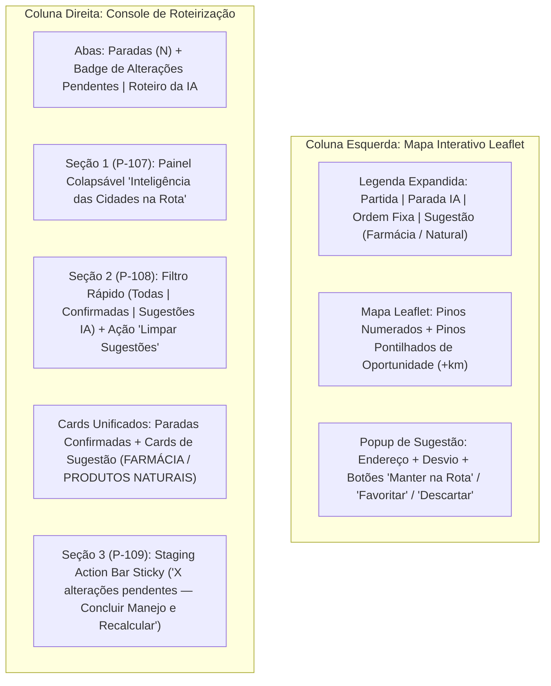

/* Hallmark · pre-emit critique: P5 H5 E5 S5 R5 V5 */

# Design Plan: Inteligência Demográfica por Cidade, Descoberta Proativa de Leads e Manejo em Lote (`commercial_routing_city_and_suggestions`) 📐🎨

> **Localização Mandatória:** `.agents/docs/design/plans/commercial_routing_city_and_suggestions.md`  
> **Autor:** Designer (`designer.md`) / `uiux-expert`  
> **Auditor:** UX Reviewer (`ux_reviewer.md`)  
> **Executor:** Desenvolvedor (`developer.md`)  
> **Referências:** [DESIGN_SYSTEM.md](file:///c:/Users/danie/Documents/Github/fitoherb-frontend-v2/.agents/docs/design/DESIGN_SYSTEM.md), [commercial_routing.md](file:///c:/Users/danie/Documents/Github/fitoherb-ai/.agents/docs/business_rules/commercial_routing.md), [frontend-ui-anti-patterns.md](file:///c:/Users/danie/Documents/Github/fitoherb-ai/.agents/rules/frontend-ui-anti-patterns.md) e [frontend-design-system-rules.md](file:///c:/Users/danie/Documents/Github/fitoherb-ai/.agents/rules/frontend-design-system-rules.md)

---

## 1. Identificação & Objetivo da Tarefa
- **User Stories Relacionadas:**
  - `US-R1` (`P-107`): Relatório de Inteligência Demográfica, Econômica e Comercial por Cidade Visitada na Rota.
  - `US-R2` (`P-108`): Descoberta Proativa de Leads no Trajeto (Sugestão de Farmácias e Lojas de Produtos Naturais não listadas).
  - `US-R3` (`P-109`): Manejo em Lote (Staging/Batch) de Sugestões e Paradas com Recálculo Diferido Único.
- **Objetivo de UX:**
  - Capacitar o vendedor Fitoherb a consultar instantaneamente o perfil socioeconômico (IBGE) de cada município da rota com argumentos comerciais acionáveis, visualizar novas oportunidades de prospecção (`Farmácias` e `Produtos Naturais`) diretamente na lista e no mapa com custo viário transparente (`+X.X km / +Y min`), e realizar o manejo rápido de múltiplas paradas/sugestões em lote (**0 ms de bloqueio de rede por clique**), disparando o recálculo OSRM/AG uma única vez ao concluir a curadoria da lista.
- **Macroestrutura & Arquétipo Visual (`uiux-expert`):**
  - **Macroestrutura:** `05-workbench.md` + `15-split-studio.md` (Console Geoespacial Split-View: Mapa Dominante à esquerda + Painel Operacional Tabular à direita).
  - **Arquétipo de Dashboard (Seção `P-107`):** **Operacional Comercial** em **Padrão F (F-Pattern)**, com títulos orientados a insights acionáveis, densidade controlada (máximo de 4 KPIs no topo + 1 acordeão executivo de cidades + timeline sequencial) e no mínimo 18% de espaço negativo (*white space*) entre cartões e seções.

---

## 2. Checklist Anti-IA (Filtro Anti-Slop Obrigatório)

> [!CAUTION]
> Qualquer violação aos itens abaixo implicará veto imediato pelo **UX Reviewer** na Etapa 4.

- [x] **Sem "AI Purple":** Zero gradientes azul-roxo (`from-blue-500 to-purple-500`). Toda a hierarquia utiliza o Verde Floresta Fitoherb (`$green-900` a `$green-50`), Âmbar Terroso (`#d97706` / `#fef3c7`) para oportunidades de farmácias, Esmeralda Botânico (`#047857` / `#ecfdf5`) para lojas de produtos naturais e Neutros Quentes (`$cream`, `$gray-100` a `$gray-900`).
- [x] **Sem 3 Colunas Mecânicas:** Os cards de municípios (`city_insights`) utilizam layout assimétrico editorial em lista vertical expansível com *KPI Strip* compacto e bloco de recomendação comercial à esquerda.
- [x] **Tipografia com Font Pairing Humano e Pureza Tipográfica:** Cabeçalhos em `Playfair Display` (sempre em estilo romano normal, **zero cabeçalhos em itálico**) pareados com `Outfit` para dados numéricos, pílulas, botões e metadados viários.
- [x] **Copywriting Honesto e Sem Buzzwords:** Zero termos genéricos (*"Seamless"*, *"Empower"*, *"Next-Gen"*) e zero emojis de brilho mágico (`✨`). Caso algum indicador demográfico não esteja disponível, exibir travessão (`—`) ou rótulo honesto (`"Estimativa regional IBGE"`).
- [x] **Zero Spinners Solitários:** Especificação completa de **Skeleton Loaders Shimmer** geométricos para o carregamento do Relatório de Cidades, das Sugestões de Leads e do estado de Recálculo em Lote.
- [x] **Zero Telas Vazias:** Especificação de **Empty States** humanos quando nenhuma sugestão inédita for encontrada no raio da rota ou quando todas as sugestões forem descartadas.
- [x] **Privacidade Visual (`P-105`):** Veto absoluto à exibição de coordenadas brutas (`latitude` / `longitude`) nos cards de cidades, nos cards de sugestões, nos popups do Leaflet e no relatório PDF.

---

## 3. Tokens do Design System Aplicados nesta Tela

*O Desenvolvedor DEVE consumir estritamente os tokens de [`src/colors.scss`](file:///c:/Users/danie/Documents/Github/fitoherb-frontend-v2/src/colors.scss) e variáveis CSS de [`src/styles.scss`](file:///c:/Users/danie/Documents/Github/fitoherb-frontend-v2/src/styles.scss):*

| Categoria | Tokens SCSS / CSS Utilizados | Valores Associados | Aplicação na Feature |
| :--- | :--- | :--- | :--- |
| **Superfícies Base** | `$white`, `$cream`, `$gray-100`, `$green-50` | `#ffffff`, `#faf8f3`, `#f5f5f0`, `#f0f8eb` | Fundo dos cards de cidade, container da lista, superfícies de sugestões |
| **Identidade Fitoherb** | `$green-900`, `$green-800`, `$green-700`, `$green-600` | `#1a2d14`, `#243d1c`, `#2e4f24`, `#38582f` | Títulos, cabeçalho do painel de cidades, CTA primário de concluir manejo |
| **Bordas e Divisores** | `$gray-200`, `$gray-300`, `$green-200`, `$green-300` | `#e8e8e0`, `#d0d0c8`, `#b5d4a8`, `#82b074` | Contornos de cards, divisores internos de métricas IBGE, estados de hover |
| **Textos e Leitura** | `$gray-900`, `$gray-700`, `var(--text-subtle)` | `#1a1a12`, `#4a4a3a`, `#8a8a7a` | Nome de municípios/clientes, endereços legíveis, legendas de apoio |
| **Lead: Farmácia (`FARMACIA`)** | `--lead-pharma-bg`, `--lead-pharma-border`, `--lead-pharma-fg` | `#fffbeb`, `#fde68a`, `#92400e` (Ícone: `#d97706`) | Badge, pino no mapa e borda lateral de sugestões do segmento Farmácia/Drogaria |
| **Lead: Produtos Naturais (`PRODUTOS_NATURAIS`)** | `--lead-natural-bg`, `--lead-natural-border`, `--lead-natural-fg` | `#ecfdf5`, `#a7f3d0`, `#065f46` (Ícone: `#059669`) | Badge, pino no mapa e borda lateral de sugestões de Lojas Naturais/Ervanários |
| **Modo Manejo (Staging Bar)** | `$green-900`, `$green-800`, `#fef3c7`, `#f59e0b` | Fundo escuro `$green-900` (`#1a2d14`) com acento âmbar `#f59e0b` | Barra sticky de alterações pendentes (`pendingStopsChanges`) |
| **Feedback Semântico (Colorblind-Safe)** | `$success` (`#27ae60`), `$warning` (`#e67e22`), `$error` (`#c0392b`) | Combinados obrigatoriamente com ícones FontAwesome | Confirmação de inclusão, alerta de lote pendente e remoção marcada |
| **Tipografia** | `'Playfair Display', serif` · `'Outfit', sans-serif` | Escala modular 0.72rem a 1.15rem | Títulos de seção em Playfair Display (romano); dados e controles em Outfit |
| **Raios e Espaçamentos** | `var(--radius-sm)` (6px), `var(--radius-md)` (8px), `var(--radius-lg)` (12px), `var(--radius-pill)` (9999px) | Grid de 4pt/8pt (`0.25rem`, `0.5rem`, `0.75rem`, `1rem`, `1.25rem`) | Pílulas de porte urbano, cards de parada/sugestão e containers |

---

## 4. Anatomia dos Componentes e Layout

A evolução visual ocorre dentro de [`seller-routes.component.html`](file:///c:/Users/danie/Documents/Github/fitoherb-frontend-v2/src/app/views/admin/components/seller-routes/seller-routes.component.html) e [`seller-routes.component.scss`](file:///c:/Users/danie/Documents/Github/fitoherb-frontend-v2/src/app/views/admin/components/seller-routes/seller-routes.component.scss), preservando a estrutura Split-Studio (Mapa à esquerda + Sidebar à direita) e introduzindo 3 novos subsistemas visuais coesos:



---

### 4.1. Seção 1 — Relatório de Inteligência das Cidades da Rota (`P-107`)

Posicionado na aba **Roteiro da IA** (`activeSidebarTab() === 'results'`), imediatamente abaixo do `.kpi-grid` e acima da `.timeline-container` (com resumo compacto também acessível no topo da lista após a primeira previsão):

1. **Cabeçalho Acordeão Executivo (`.city-insights-panel__header`):**
   - **Título orientado a Insight (Dashboard Designer):** Em vez de apenas *"Cidades"*, exibe dinamicamente um título acionável, ex.:
     - `"Panorama Municipal: 2 cidades no roteiro (1 Metrópole · 1 Polo Regional)"`
   - **Subtítulo / Metadados:** `"Dados demográficos IBGE e foco comercial Fitoherb"` + contador badge (`{{ cityInsights().length }} {{ cityInsights().length === 1 ? 'município' : 'municípios' }}`).
   - **Controle Colapsar/Expandir:** Botão acessível (`aria-expanded`) com ícone `fa-solid fa-chevron-down` rotacionando `180deg` em transição suave (`200ms ease`). Por padrão, inicia **expandido** quando há até 2 cidades ou **compactado com resumo do 1º município** quando há 3+ cidades para preservar o *white space* da timeline.

2. **Card de Município (`.city-insight-card`):**
   - **Linha 1 — Identidade Municipal e Porte Urbano:**
     - Ícone `fa-solid fa-city` (`$green-600`) + Nome do Município e UF em destaque (`Outfit`, `0.96rem`, `font-weight: 700`, `$green-900`, ex: `Salvador - BA`) + Código IBGE discreto (`IBGE: 2927408` em `0.7rem`, `var(--text-subtle)`).
     - **Badge de Porte Demográfico (`.city-tier-badge`)** com codificação semântica e ícone:
       - `METROPOLIS` (*Metrópole > 1M hab*): Fundo `$green-800` (`#243d1c`), texto `$white`, ícone `fa-solid fa-building-columns`.
       - `REGIONAL_HUB` (*Polo Regional 300k–1M hab*): Fundo `$green-100` (`#ddefd6`), texto `$green-900`, borda `$green-300`, ícone `fa-solid fa-network-wired`.
       - `MEDIUM_CITY` (*Cidade Média 100k–300k hab*): Fundo `#eff6ff`, texto `#1e40af`, borda `#bfdbfe`, ícone `fa-solid fa-building`.
       - `SMALL_TOWN` (*Pequeno Porte < 100k hab*): Fundo `$cream` (`#faf8f3`), texto `$gray-700`, borda `$gray-300`, ícone `fa-solid fa-tree-city`.
   - **Linha 2 — Região / Polo Econômico:**
     - Pílula contextual (`fa-solid fa-map-pin` + `Região Metropolitana de Salvador` ou `Portal do Sertão`).
   - **Linha 3 — Strip Assimétrico de Indicadores Demográficos e Econômicos (`.city-metrics-strip`):**
     - Grid de 3 células compactas (`grid-template-columns: repeat(3, minmax(0, 1fr))`) com fundo `$cream` (`#faf8f3`) e borda `$gray-200`:
       1. **População (IBGE):** Ex: `2.417.678 hab` (ou `2,42 mi hab` em telas `< 375px`).
       2. **Densidade:** Ex: `3.486 hab/km²`.
       3. **PIB per Capita:** Ex: `R$ 27.450/ano`.
   - **Linha 4 — Métricas Operacionais da Rota na Cidade (`.city-route-counters`):**
     - Três chips horizontais de alto contraste:
       - `✅ {{ city.confirmed_stops_count }} parada(s) confirmada(s)` (`$green-50` / `$green-800`).
       - `💡 +{{ city.suggested_leads_count }} oportunidade(s) no caminho` (`#fffbeb` / `#92400e`, exibido com destaque se `> 0`).
       - `⏱️ ~{{ city.estimated_dwell_minutes }} min na cidade` (`$gray-100` / `$gray-700`).
   - **Linha 5 — Foco Comercial Recomendado Fitoherb (`.city-commercial-focus`):**
     - Callout editorial com barra lateral esquerda de `3px solid $green-600`, fundo `$green-50`, ícone `fa-solid fa-leaf` e texto humano de recomendação comercial:
       - *Exemplo:* `"Foco Fitoherb: Forte presença de redes de drogarias e empórios de suplementação esportiva nos corredores comerciais."`

---

### 4.2. Seção 2 — Sugestões de Novas Farmácias e Lojas de Produtos Naturais (`P-108`)

As sugestões descobertas pelo `fitoherb-ai` são injetadas com diferenciação visual imediata tanto na **Lista de Manejo** quanto na **Timeline** e no **Mapa Leaflet**:

1. **Barra de Filtro e Resumo de Sugestões no Topo da Lista (`.suggestions-toolbar`):**
   - Exibida quando houver pelo menos 1 sugestão ativa ou pendente na rota:
   - Pílulas de filtro rápido:
     - `Todos ({{ totalListCount }})`
     - `Confirmados ({{ confirmedCount }})`
     - `Sugestões IA ({{ suggestionsCount }})`
   - Botão de ação rápida secundária: `"Descartar todas as sugestões"` (`fa-regular fa-trash-can`), que marca todas as sugestões como removidas em lote (entrando no estado de Staging `P-109`, sem chamada de rede).

2. **Anatomia do Card de Estabelecimento Sugerido (`.stop-item-card--suggestion`):**
   - **Diferenciação Estrutural:**
     - Borda tracejada refinada (`1.5px dashed`) + barra lateral esquerda de `4px solid`:
       - Se `suggestion_category === 'FARMACIA'`: Borda `#f59e0b`, fundo sutil `#fffdf7`.
       - Se `suggestion_category === 'PRODUTOS_NATURAIS'`: Borda `#10b981`, fundo sutil `#f4fbf7`.
   - **Cabeçalho do Card:**
     - **Badge Principal `SUGESTÃO` (`.badge-suggestion`):**
       - `FARMACIA`: Ícone `fa-solid fa-mortar-pestle` (ou `fa-capsules`) + texto `"SUGESTÃO · FARMÁCIA"` em fundo `#fef3c7`, texto `#92400e`, borda `#fde68a`.
       - `PRODUTOS_NATURAIS`: Ícone `fa-solid fa-seedling` (ou `fa-leaf`) + texto `"SUGESTÃO · LOJA NATURAL"` em fundo `#d1fae5`, texto `#065f46`, borda `#a7f3d0`.
     - **Chip de Custo Viário / Desvio (`.detour-chip`):**
       - Exibe com transparência o impacto no trajeto: `<i class="fa-solid fa-route"></i> +{{ stop.detour_distance_km?.toFixed(1) }} km ({{ '+' + stop.detour_time_minutes + ' min' }})`.
   - **Corpo do Card:**
     - Nome do estabelecimento em `Outfit` (`0.95rem`, `font-weight: 700`, `$green-900`) + Endereço formatado completo (Rua, número, bairro e cidade — **zero coordenadas**).
     - Motivo/Relevância comercial curta (ex: `"No corredor viário próximo a {{ stop.nearest_stop_name || stop.city }}"`).
   - **Barra de Ações Rápidas do Card de Sugestão (`.suggestion-card__actions`):**
     - **Botão 1 — Confirmar / Manter na Rota (`.btn-suggestion-keep`):**
       - `<i class="fa-solid fa-check"></i> Manter na Rota` (Converte o item de sugestão provisória para parada confirmada no lote atual; quando já mantido, exibe estado ativo `"Mantida na Rota"` com ícone `fa-solid fa-circle-check`).
     - **Botão 2 — Salvar nos Favoritos (`.btn-suggestion-fav`):**
       - `<i class="fa-regular fa-star"></i> Favoritar` (Salva o lead na tabela `saved_locations` como `FAVORITE` para futuras rotas e muda o ícone para `fa-solid fa-star` dourado `#eab308`).
     - **Botão 3 — Remover da Lista (`.btn-suggestion-remove`):**
       - `<i class="fa-regular fa-trash-can"></i> Remover` (Remove imediatamente da lista local sem chamar o backend e incrementa o contador da **Staging Action Bar** `P-109`).

3. **Diferenciação nos Marcadores e Popups do Mapa Leaflet (`::ng-deep .custom-pin-wrapper`):**
   - **Legenda do Mapa (`.map-legend`):** Adiciona o chip `<span class="legend-chip chip--suggestion"><span class="dot dot--suggestion"></span> Sugestão de Lead</span>`.
   - **Pino no Mapa (`pin--suggestion-pharma` e `pin--suggestion-natural`):**
     - Bolha com borda dupla/pontilhada branca, ícone temático (`💊`/`fa-mortar-pestle` para Farmácia em gradiente âmbar `#f59e0b -> #d97706`; `🌿`/`fa-seedling` para Loja Natural em gradiente esmeralda `#10b981 -> #047857`) e pílula superior indicando `+{{ detour_distance_km }}km`.
   - **Popup Interativo no Mapa:**
     - Exibe badge da categoria, nome, endereço legível, desvio estimado (`+X.X km`) e botões rápidos diretamente no popup: **"Manter na Rota"** e **"Remover Sugestão"**.

---

### 4.3. Seção 3 — Modo de Manejo em Lote com Recálculo Diferido (`P-109`)

Para cumprir estritamente a regra `P-109` (zero chamadas HTTP de recálculo a cada remoção/adição individual):

1. **Comportamento de Estado Local Instantâneo (`0 ms` Network Latency):**
   - Ao remover uma sugestão, remover uma parada existente, descartar todas as sugestões ou confirmar uma sugestão na lista, o componente atualiza apenas os Signals locais de trabalho (`stagedStops`, `pendingBatchChangesCount`, `hasPendingBatchChanges = computed(() => pendingBatchChangesCount() > 0)`).
   - O botão ou card removido sai imediatamente da lista ativa (com animação CSS `fadeOutCollapse 180ms ease-out`), e a **Staging Action Bar** informa o resumo exato das alterações pendentes.

2. **Barra Flutuante / Sticky de Manejo em Lote (`.batch-staging-bar`):**
   - **Posicionamento:** Fixada (`position: sticky; bottom: 0; z-index: 50`) na base do `.sidebar-card` (visível tanto na aba **Paradas** quanto na aba **Roteiro da IA** sempre que `hasPendingBatchChanges() === true`).
   - **Estética de Alto Contraste (Anti-Slop):**
     - Fundo `$green-900` (`#1a2d14`) com borda superior de `2px solid #f59e0b` (Âmbar de atenção operacional) e sombra elevada `0 -8px 24px rgba(26, 45, 20, 0.22)`.
   - **Anatomia Interna:**
     - **Linha Superior — Indicador de Lote Pendente:**
       - Badge pulsante discreta em âmbar (`<span class="staging-count-badge">{{ pendingBatchChangesCount() }}</span>`) + Texto claro e humano:
       - **`"{{ pendingBatchChangesCount() }} {{ pendingBatchChangesCount() === 1 ? 'alteração pendente' : 'alterações pendentes' }} na lista"`**
       - Subtítulo explicativo: `"Remova ou mantenha quantos locais desejar. O recálculo viário será feito uma única vez ao concluir."`
     - **Linha Inferior — Botões de Decisão de Lote:**
       - **Botão Primário (`.btn-commit-batch`):**
         - `<i class="fa-solid fa-rotate"></i> Concluir Manejo e Recalcular Rota`
         - Cor: Gradiente Esmeralda/Folha (`#10b981` ➔ `$green-600`), texto branco, `font-weight: 700`. Ao clicar, envia uma **única requisição** ao backend com a lista final consolidada.
       - **Botão Secundário (`.btn-undo-batch`):**
         - `<i class="fa-solid fa-rotate-left"></i> Desfazer ({{ pendingBatchChangesCount() }})`
         - Cor: Fundo transparente com borda `rgba(255, 255, 255, 0.28)` e texto `$cream` (`#faf8f3`). Restaura instantaneamente o snapshot original da lista antes do manejo.

---

### 4.4. Atualização do Manifesto PDF (`P-105` + `P-107`)

No layout de exportação A4 (`exportPdf` no frontend e `pdf_service.py` no `fitoherb-ai`):
- **Quadro "Resumo de Inteligência Municipal da Rota":** Inserido entre os KPIs gerais e a Tabela Sequencial de Visitas.
- Tabela limpa com colunas: **Município/UF**, **Porte Urbano**, **População (IBGE)**, **PIB per Capita**, **Visitas na Cidade** e **Foco Comercial Fitoherb**.
- **Trava de Privacidade (`P-105`):** Nenhuma coluna ou nota de rodapé pode conter latitude/longitude. Sugestões que foram mantidas/confirmadas pelo vendedor aparecem na tabela de visitas com a tag `[Oportunidade Descoberta - Farmácia/Natural]`. Sugestões descartadas no manejo não saem no PDF final.

---

## 5. Matriz Completa dos 8 Estados Visuais Obrigatórios

Cada novo componente interativo implementa rigorosamente os 8 estados exigidos pela skill `uiux-expert`:

| Componente | 1. `default` | 2. `hover` | 3. `:focus-visible` | 4. `:active` | 5. `disabled` | 6. `loading` (Skeleton Shimmer) | 7. `error` | 8. `success` |
| :--- | :--- | :--- | :--- | :--- | :--- | :--- | :--- | :--- |
| **Acordeão e Cards `city_insights` (`P-107`)** | Fundo `$white`, borda `$gray-200`, header em `$green-50` com badge de porte e strip de 3 métricas IBGE. | Borda `$green-300`, sombra `0 4px 12px rgba(56,88,47,0.08)`, chevron destaca em `$green-700`. | `outline: 2px solid rgba(56, 88, 47, 0.45); outline-offset: 2px;` no botão do acordeão. | `transform: scale(0.995)` no cabeçalho ao alternar expansão. | Quando rota ainda não foi prevista, aba resultados fica `disabled` (`opacity: 0.45`). | **2 Cards Skeleton Shimmer** com barra de título (`140px x 18px`), badge (`80px x 20px`) e 3 blocos de métricas (`100% x 44px`) com gradiente linear animado. | Banner contextual discreto: *"Dados demográficos em modo estimado offline"* com ícone `fa-circle-info` sem quebrar a tela. | Indicador verde `✅ Dados IBGE sincronizados` e contagem de oportunidades por cidade ativa. |
| **Card de Sugestão de Lead (`P-108`)** | Borda tracejada (`#f59e0b` Farmácia / `#10b981` Natural), badge `SUGESTÃO`, chip `+X.X km` e 3 botões rápidos. | Elevação `translateY(-1px)`, sombra `0 6px 14px rgba(26,45,20,0.08)` e destaque do pino correspondente no mapa. | Anel de foco de `2px solid $green-600` (`outline-offset: 2px`) no card e em cada botão de ação rápida. | Clique em *"Manter"* ou *"Remover"* aplica `scale(0.97)` por `120ms`. | Botões desabilitados (`opacity: 0.5; cursor: not-allowed`) apenas enquanto `isRecalculating()` estiver em execução. | **3 Cards Skeleton Shimmer** imitando a geometria do card de sugestão durante `isOptimizing()`. | Caso falhe ao favoritar sugestão, exibe toast de erro e borda vermelha temporária (`$error`) no botão Favoritar. | Ao clicar em **"Manter na Rota"**, a borda tracejada torna-se sólida `$green-600` e exibe badge `✅ Mantida no Roteiro`. Ao favoritar, estrela fica dourada (`#eab308`). |
| **Staging Action Bar (`P-109`)** | Oculta quando `pendingBatchChangesCount() === 0`; aparece com `slideUp 220ms cubic-bezier(0.16,1,0.3,1)` na primeira alteração da lista. | Botão *"Concluir Manejo e Recalcular"* ilumina gradiente para `$green-500` e eleva `translateY(-1px)`. Botão *"Desfazer"* ganha fundo `rgba(255,255,255,0.12)`. | `outline: 2px solid #fde047; outline-offset: 2px;` (alto contraste sobre o fundo escuro `$green-900`). | `transform: translateY(0) scale(0.98)` no clique de confirmação de lote. | Enquanto `isRecalculating() === true`, ambos os botões ficam `disabled` para evitar duplo envio. | O botão primário exibe `"Recalculando rota consolidada..."` e a timeline exibe **Skeleton Shimmer overlay** nos horários até a resposta única chegar. | Se o recálculo em lote falhar na rede, preserva o estado de Staging intacto (zero perda do trabalho de curadoria) e exibe botão `"Tentar Recalcular Novamente"`. | Ao concluir o recálculo único, a barra recolhe suavemente e exibe Toast: `"Rota atualizada com sucesso!"`. |

---

## 6. Especificação de Skeleton Loaders e Empty States

### 6.1. Skeleton Loaders Shimmer (Proibido Spinner Isolado)
Durante a previsão (`isOptimizing()`) ou recálculo consolidado do lote (`isRecalculating()`):
```scss
@keyframes fitoShimmer {
  0% { background-position: -200% 0; }
  100% { background-position: 200% 0; }
}

.skeleton-shimmer {
  background: linear-gradient(90deg, $gray-100 25%, $gray-200 50%, $gray-100 75%);
  background-size: 200% 100%;
  animation: fitoShimmer 1.5s infinite linear;
  border-radius: var(--radius-sm);
}
```
- **Skeleton de Inteligência de Cidades:** 2 blocos `.city-insight-card--skeleton` contendo linha de título (`60%`), pílula de porte (`25%`), grade de 3 caixas (`48px` de altura) e barra de recomendação comercial (`36px` de altura).

### 6.2. Empty States Contextuais
1. **Quando todas as sugestões são descartadas pelo vendedor no manejo:**
   - Exibe banner compacto amigável acima da lista:
     - Ícone `fa-solid fa-broom` (`$green-600`), texto `"Você descartou as sugestões extras. Clique em 'Concluir Manejo e Recalcular Rota' abaixo para confirmar seu roteiro enxuto, ou em 'Desfazer' para restaurá-las."`
2. **Quando a rota otimizada não encontra novos estabelecimentos inéditos no raio (`suggested_leads_count === 0`):**
   - Exibe nota discreta no rodapé do painel de cidades:
     - `<i class="fa-solid fa-circle-check"></i> Todas as farmácias e lojas naturais mapeadas neste corredor já constam na sua carteira ou lista atual.`

---

## 7. Responsividade Móvel Inegociável (`320px` / `375px` / `414px` / `768px` / `1024px+`)

| Breakpoint | Comportamento Estrutural e Adaptações Visuais |
| :--- | :--- |
| **`320px – 375px` (Mobile Compacto)** | - Zero scroll horizontal (`overflow-x: clip`).<br>- `.city-metrics-strip` muda de 3 colunas para `grid-template-columns: 1fr` (ou `repeat(2, minmax(0, 1fr))` com PIB per capita ocupando `grid-column: 1 / -1`), evitando truncamento de números.<br>- Botões de ação rápida da sugestão (`Manter`, `Favoritar`, `Remover`) organizam-se em barra flexível com `min-height: 38px` e texto nunca quebrando em 2 linhas (`white-space: nowrap`).<br>- `.batch-staging-bar` empilha os botões *"Concluir Manejo e Recalcular Rota"* (full-width `100%`) e *"Desfazer Alterações"* logo abaixo. |
| **`414px – 640px` (Mobile Standard)** | - `.city-metrics-strip` mantém 3 colunas com fonte numérica ajustada para `0.8rem` e `min-width: 0`.<br>- Pílulas de filtro (`Todas | Confirmadas | Sugestões IA`) com scroll horizontal suave invisível (`overflow-x: auto; scrollbar-width: none`) caso necessário. |
| **`768px – 1024px` (Tablet)** | - Layout principal `.routes-main-grid` em 1 coluna (`grid-template-columns: 1fr`), mapa com `460px` de altura e cards de cidades exibidos em grid de 2 colunas (`grid-template-columns: repeat(auto-fit, minmax(280px, 1fr))`). |
| **`> 1024px` (Desktop Split-Studio)** | - `.routes-main-grid` em `1fr 420px` (ou `1fr 440px` para acomodar confortavelmente os indicadores IBGE e chips de desvio sem aperto visual).<br>- `.batch-staging-bar` ancorada na base da coluna direita com botões lado a lado. |

---

## 8. Guia de Implementação HTML/SCSS para o Desenvolvedor

### 8.1. Estrutura de Classes SCSS Recomendada (`seller-routes.component.scss`)
- `.city-insights-panel`: Container colapsável na aba `results` (e resumo na aba `stops`).
  - `.city-insights-panel__header`: Botão full-width com título de insight, contador de cidades e ícone chevron.
  - `.city-insights-list`: Lista com `display: flex; flex-direction: column; gap: 0.75rem;`.
  - `.city-insight-card`: Card individual do município com `.city-tier-badge`, `.city-metrics-strip`, `.city-route-counters` e `.city-commercial-focus`.
- `.suggestions-toolbar`: Barra de filtro rápido (`ALL`, `CONFIRMED`, `SUGGESTIONS`) + botão `"Limpar sugestões"`.
- `.stop-item-card--suggestion`: Modificador do `.stop-item-card` para leads sugeridos (`&.suggestion--pharma` e `&.suggestion--natural`).
  - `.badge-suggestion`, `.detour-chip`, `.suggestion-card__actions` (`.btn-suggestion-keep`, `.btn-suggestion-fav`, `.btn-suggestion-remove`).
- `.batch-staging-bar`: Barra sticky de manejo em lote (`P-109`) com `.staging-count-badge`, `.btn-commit-batch` e `.btn-undo-batch`.
- `:host ::ng-deep .custom-pin-wrapper.pin--suggestion-pharma` e `.pin--suggestion-natural`: Marcadores de mapa distintos para leads sugeridos.

---

## 9. Critérios de Aceite para UX Reviewer (DoD Visual — Etapa 4)
- [ ] Carimbo Hallmark `/* Hallmark · pre-emit critique: P5 H5 E5 S5 R5 V5 */` respeitado na implementação.
- [ ] Todos os estilos consomem variáveis do Design System (`src/colors.scss` e `src/styles.scss`), sem "AI Purple" e sem cabeçalhos em itálico.
- [ ] Painel **"Inteligência das Cidades na Rota" (`P-107`)** exibe População IBGE, Badge de Porte Urbano, Densidade, PIB per capita, Região/Polo, Foco Comercial Fitoherb e contadores de paradas/sugestões/tempo na cidade.
- [ ] Sugestões de **Farmácias (`FARMACIA`)** e **Lojas de Produtos Naturais (`PRODUTOS_NATURAIS`) (`P-108`)** possuem distinção cromática e iconográfica clara tanto nos cards da lista quanto nos pinos e popups do mapa Leaflet, exibindo o chip de desvio (`+X.X km / +Y min`) e ações de *Manter*, *Favoritar* e *Remover*.
- [ ] **Modo de Manejo em Lote (`P-109`)** funciona com resposta visual instantânea (`0 ms`), exibindo a **Staging Action Bar** com contador de alterações pendentes, botão **"Concluir Manejo e Recalcular Rota"** (que dispara apenas 1 requisição consolidada) e botão **"Desfazer"**.
- [ ] Nenhuma coordenada bruta (`latitude`/`longitude`) é exibida na interface ou no PDF exportado (`P-105`).
- [ ] Responsividade perfeita verificada em `320px`, `375px`, `414px` e `768px` sem scroll horizontal.
